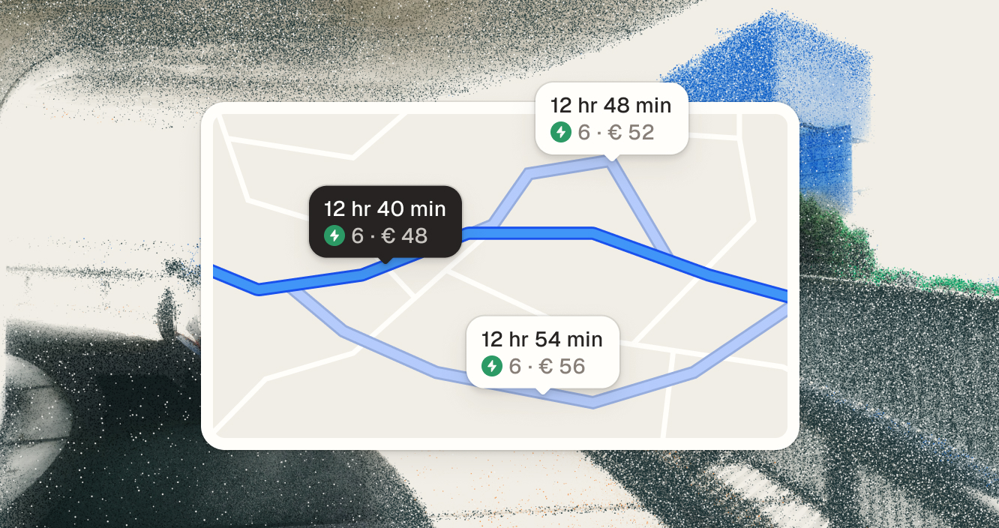

## Alternative routes

You can now request geographically different alternative routes alongside the recommended route during route calculation. This allows drivers and dispatchers to evaluate alternative paths based on their preferences while maintaining the same trip constraints. You can specify up to 2 alternative routes.

### Fixes & improvements

    
Fixes

    - Fixed an issue where providing empty `via` waypoints without geometry, location, or station IDs in `createRoute` failed silently with a `not_found` status instead of returning a `ROUTE_VIA_LOCATION_MISSING` validation error.
    - Fixed an issue in `operatorList` where queries using ranking filters returned empty results if the project had no excluded countries configured, ensuring operators matching ranking preferences are returned correctly.

