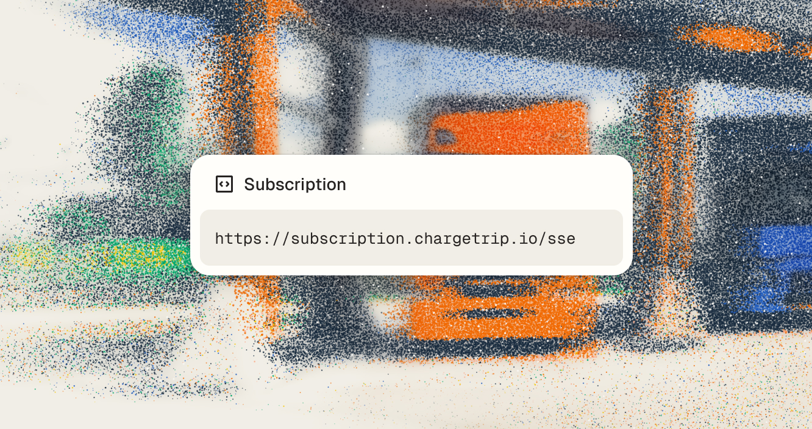

## Subscriptions v2

Wir haben einen neuen Subscription-Service gestartet, der unter einer eigenen Domain (`subscription.chargetrip.io`) gehostet wird und höhere Zuverlässigkeit, Standard-Subprotokolle und neue Transportoptionen bietet.

- Verbinden Sie sich per WebSocket über `wss://subscription.chargetrip.io/ws` mit dem modernen Protokoll `graphql-transport-ws`;
- Streamen Sie Subscriptions über HTTP mit Server-Sent Events über `https://subscription.chargetrip.io/sse`;
- Aktive Subscription-Verbindungen werden automatisch geschlossen, sobald eine Ressource ihren Endzustand erreicht (etwa `done`, `error` oder `not_found` bei Routen/Isolinien sowie `finished` oder `error` bei der Navigation);
- Fehler-Payloads folgen nun einheitlichen GraphQL-Fehlerkonventionen mit strukturierten Extensions-Metadaten.

### Boosting-Gruppen von Stationen in Station-Queries

Wir haben Station-Queries erweitert, sodass sich erkennen lässt, ob eine Station zu einer aktiven Boosting-Gruppe gehört.

- Das Feld `boosting_group_ids` wurde dem Typ `Station` in den Queries `station`, `stationList` und `stationAround` hinzugefügt;
- Es gibt ein Array der aktiven Boosting-Gruppen-IDs zurück, die für Ihr Projekt konfiguriert sind, oder eine leere Liste (`[]`), wenn die Station derzeit nicht geboostet wird.

  
Fehlerbehebungen

  
  - Es wurde ein Problem behoben, bei dem Routen mit mehreren Fährverbindungen dazu führen konnten, dass Ladestationen mit einem negativen Ladezustand erreicht wurden.
  - Es wurde ein Problem behoben, bei dem die Berechnung von Routen zwischen sehr nah beieinanderliegenden Start- und Zielpunkten einen Fehler wegen ungültigem Linienzug erzeugte und mit einer 404-Antwort fehlschlug.

