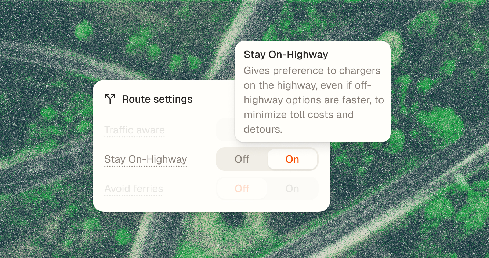

## Präferenz für Autobahn-Laden

Diese neue Option bevorzugt Ladepunkte an der Autobahn, auch in Fällen, in denen Stationen abseits der Autobahn eine schnellere Route bieten könnten.

  
Fehlerbehebungen

  - Es wurde ein Problem behoben, bei dem Routen, die ihren Weg zurückverfolgten, mit einem negativen Ladezustand enden konnten.
  - Es wurde ein Problem behoben, bei dem die Ladezeit am letzten Stopp falsch berechnet wurde, wenn der Lademodus `OPTIMIZE_TRAVEL_TIME` mit einem benutzerdefinierten Ladezustand am Ziel kombiniert wurde.

