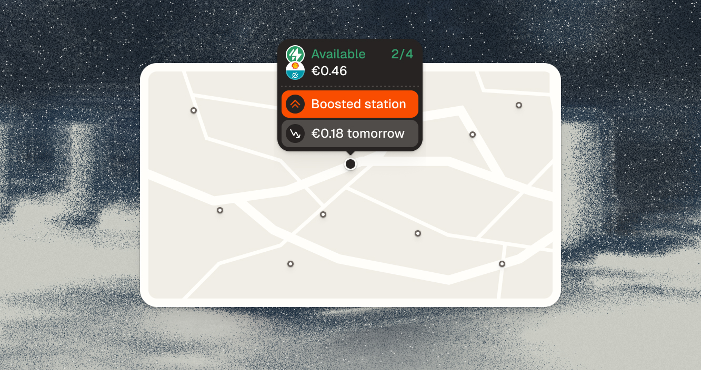

## Routen beeinflussen mit Station Boosting

Für Unternehmen, die die Netzauslastung maximieren, Partnervereinbarungen einhalten oder Fahrer zu bestimmten margenstarken Ladestationen lenken möchten, bietet Station Boosting eine unkomplizierte Möglichkeit, Routing-Entscheidungen zu beeinflussen. Diese Funktion ist in Alpha verfügbar und gibt Ihnen direkte Kontrolle darüber, wie bestimmte Ladestandorte priorisiert werden, ohne unnötigen betrieblichen Aufwand zu verursachen.

- Gezielte Kundengruppen: Erstellen Sie bis zu 5 getrennte Gruppen pro Umgebung (mit bis zu 50 bestimmten Stationen pro Gruppe), um gezielte regionale oder zeitbasierte Kampagnen durchzuführen.

Wenn Sie diese Funktion testen und Ladevolumen zu hoch priorisierter Hardware lenken möchten, wenden Sie sich an Ihren Customer Success Manager, der Ihre Konfiguration verwaltet.

### Konfigurierbarer maximaler Ladezustand beim Laden und erweiterte Batteriegrenzen
Fahrer können jetzt den maximalen Ladezustand (State of Charge, SoC) für Ladestopps zwischen 80 % und 100 % konfigurieren und Fahrten planen, die bei der Ankunft einen höheren Restladezustand der Batterie erfordern.

- Übergeben Sie `maximum_state_of_charge` (80–100 %) in `createRoute` (`RouteVehicleChargingInput`). Ist der Wert gesetzt, können Fahrzeuge bei geplanten oder ungeplanten Stopps über die Standardgrenze von 80 % hinaus laden, und zwar in den Modi `ALWAYS_TO_MAX_CHARGE` und `OPTIMIZE_TRAVEL_TIME`;
- Konfigurieren Sie `final_state_of_charge` bis zu 80 % der Batteriekapazität des Fahrzeugs (zuvor 60 %);
- Zwei neue SoC-Warnungen für Etappen wurden hinzugefügt: `risk_margin_soc_not_possible`, wenn der erwartete Ladezustand bei Ankunft unter die Sicherheits-Risikomarge fällt, und `final_soc_below_risk_margin`, wenn der angeforderte Ladezustand am Ziel unter die sichere Risikomarge fällt.

  
Verbesserungen

  - Die Array-Filter `type` und `region` wurden zu `vehicleMakes` (`VehicleMakesFilter`) hinzugefügt. Damit können Clients Marken filtern, die bestimmte Fahrzeugtypen anbieten oder in festgelegten geografischen Regionen tätig sind.
  - `model_count` wurde zu `VehicleMake` und `vehicle_count` zu `VehicleModel` hinzugefügt, um die Echtzeit-Anzahl zugänglicher Modelle je Hersteller und Fahrzeuge je Modell bereitzustellen.
  - Cursor-basierte Pagination-Argumente (`first` und `after`) wurden zusammen mit `total_count` und `page_info` in der Query `vehicleMakes` umgesetzt.
  - `vehicleMakes` und Fahrzeug-Queries geben nun länderspezifische Markenlogos zurück, wenn ein Länderfilter angegeben ist, und greifen auf globale Bilder zurück, wenn keine lokalisierten Assets konfiguriert sind.

  
Fehlerbehebungen

  - Es wurde ein Problem in `vehicleList` behoben, bei dem das Filtern nach Herstellername nach der Einführung von Hersteller-IDs fehlschlug. Die Abwärtskompatibilität wurde wiederhergestellt, sodass `filter.make` sowohl Hersteller-IDs als auch Herstellernamen akzeptiert.
  - Es wurde ein Problem behoben, bei dem Routen, die mit einem Anfangsladezustand unterhalb der Sicherheits-Risikomarge (`initialSOC < safeRiskMargin`) begannen, bis zu einem Batteriestand von 0 % fuhren, anstatt zur nächsten verfügbaren Ladestation zu routen.
  - Es wurde ein Problem behoben, bei dem die Summe der Dauern der einzelnen Etappenabschnitte nicht mit den gesamten Fahrdauern (`durations.driving`) in den Routendetails übereinstimmte.

