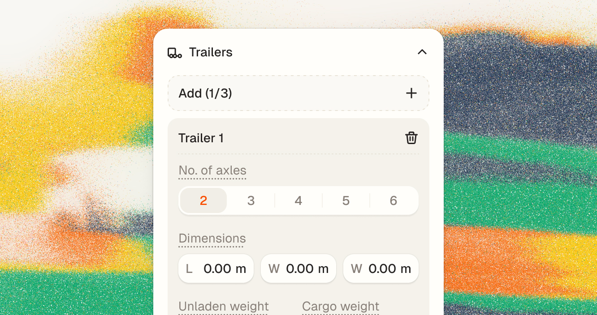

## Lkw-Routing

Wir haben unsere eigene Lkw-Routing-Engine im Backend offiziell gestartet. Diese eigenständige API-Funktion ist über eine völlig neue Reihe von Abfragen und Mutationen verfügbar und berücksichtigt Gewichtsbeschränkungen, Durchfahrtshöhen und lkw-spezifische Energieverbrauchsmodelle, um zuverlässige gewerbliche Routen für schwere Elektrofahrzeuge zu erstellen.

  
Verbesserungen

  - Verbesserte Validierung und Fehlerdiagnose bei der Angabe von Ladestationen als Via-Punkte in createRoute: Wenn Laden nicht möglich ist, werden explizite Fehlercodes zurückgegeben (`ROUTE_STATION_OUT_OF_SERVICE`, `ROUTE_STATION_INVALID_CHARGER` und das überarbeitete `ROUTE_STATION_INVALID_SPEED`). Zusätzlich wurde die Etappenwarnung via_station_below_minimum_power eingeführt, wenn die verfügbaren Anschlüsse unter dem angeforderten Schwellenwert minimum_power liegen.

  
Fehlerbehebungen

  - Es wurde ein Problem behoben, bei dem die gesamten Fahr- und Fahrtdauern (`durations.driving` und `durations.total`) bei empfohlenen und alternativen Routen Staubedingte Verzögerungen nicht enthielten, wenn `traffic_aware` aktiviert war.
  - Es wurde ein Problem behoben, bei dem Routen, die an einer Ladestation endeten, auf der letzten Etappe eine fehlerhafte Ladedauer erfassten und die Gesamtzahl `charges` der Route um einen zusätzlichen Ladestopp erhöhten.
  - Es wurde ein Problem behoben, bei dem das Filtern von `vehicleList` nach `make`- oder `model`-Zeichenfolgen mit Sonderzeichen (wie `Lynk&Co`, `e.GO`, `ID.7` oder `N°4 E-Tense`) leere Ergebnisse lieferte.
  - Es wurde ein Problem in `amenityList` behoben, bei dem gefilterte POI-Suchergebnisse nicht mit der Gesamtzahl der Ausstattungsmerkmale der Station übereinstimmten.

