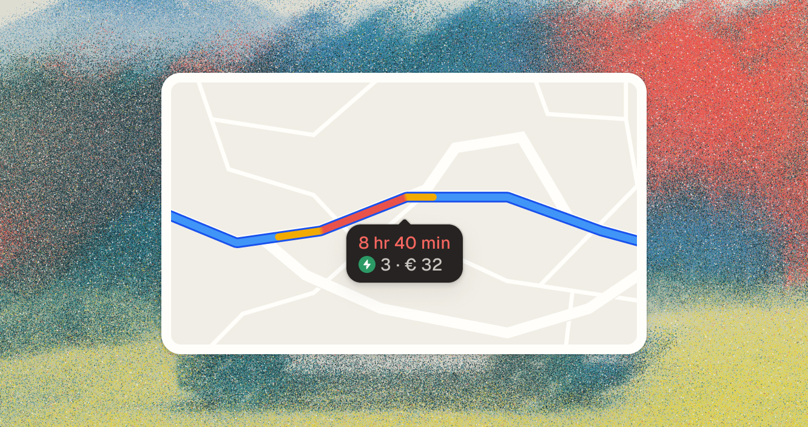

## Verkehr

Aktivieren Sie verkehrsabhängiges Routing, um bei der Routenberechnung die globale Verkehrslage zu berücksichtigen. Verkehr und Störungen bei gleichzeitiger Optimierung des Ladens zu berücksichtigen, galt lange als der heilige Gral der Routenoptimierung für EVs. Wenn die Funktion aktiviert ist, enthält die Routenantwort:

- **Abschnitte** der Route, die vom Verkehr betroffen sind;
- **Staugrad** auf diesen Abschnitten;
- **Verzögerung**, die zur Gesamtdauer der Route hinzukommt.

Das liefert eine realistischere Schätzung der Reisezeit, wenn die Verkehrslage die Route beeinflusst, und ermöglicht es Ihnen, Ihren Kunden global optimierte Routen für die Turn-by-Turn-Navigation bereitzustellen.

### Routenwarnungen

Routing ist oft ein Best-Effort-Prozess. Manchmal kann die Routing-Engine nicht alle angeforderten Bedingungen vollständig erfüllen. Warnungen helfen zu erklären, warum eine Route von der ursprünglichen Anfrage abweichen kann. Beispiele:

- **Nicht verfügbare Betreiber**: Stationen mit bevorzugten Lade-Betreibern sind auf dieser Etappe der Route nicht verfügbar.
- **Einschränkungen**: Der angeforderte End-Ladezustand konnte nicht erreicht werden.

Warnungen ermöglichen es Front-End-Teams, Fahrern nützliches Feedback anzuzeigen, oder geben Entwicklern tiefere Einblicke in das Routing-Verhalten. Dadurch lassen sich Routing-Ergebnisse leichter nachvollziehen und Sonderfälle leichter analysieren.

  
Verbesserungen

    - Die Validierung des Betreiber-Rankings in `createRoute` wurde gelockert: Wenn Betreiberpräferenzen (bevorzugt oder erforderlich) angefordert werden, ohne dass in der Anfrage Stufen angegeben oder in den Projekteinstellungen konfiguriert sind, ist die Routenberechnung nun erfolgreich, ohne Betreiber zu priorisieren, und gibt in getRoute eine nicht blockierende Warnung `OPERATOR_PREFERENCES_NOT_FOUND` zurück (ebenfalls dokumentiert über /public/warnings).

  
Fehlerbehebungen

  - Es wurde ein Problem behoben, bei dem das Suchen oder Filtern der Fahrzeugliste (vehicleList) nach Zeichenfolgen mit Klammern (etwa Hersteller- oder Modellnamen) zu Fehlern beim Parsen der Abfrage führte und einen internen Serverfehler zurückgab.

