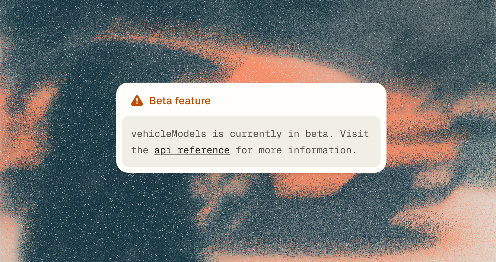

## Warnungen zu experimentellen und veralteten API-Funktionen

Wir haben Lebenszyklus-Warnungen in den GraphQL-Antwort-Extensions eingeführt, die Entwickler informieren, sobald eine angeforderte Operation oder ein Feld in Alpha oder Beta ist oder zur Einstellung vorgesehen ist. Das schafft direkte Transparenz über den Reifegrad von Funktionen und anstehende Einstellungen, ohne API-Antworten zu beeinträchtigen.

Das ist neu:

- **Lebenszyklus-Benachrichtigungen**: Sie erhalten strukturierte Hinweise unter `extensions.warnings`, sobald Ihre Anfrage Schema-Elemente berührt, die mit `@experimental(stage: "alpha")`, `@experimental(stage: "beta")` oder `@chargetripdeprecated` gekennzeichnet sind;
- **Konsistente Auslieferung**: Warnungen sind in allen Antworten enthalten, unabhängig davon, ob die Operation erfolgreich ist oder Fehler zurückgibt.

  
Verbesserungen

    - `createIsoline` unterstützt nun über den neuen `weather`-Input benutzerdefinierte Wetterbedingungen (`temperature`, `air_pressure` und `solar_irradiance`) neben den Standardvorgaben (`summer`, `winter`, `actual`). Der Input `season` ist damit veraltet.
    - Warnungen zum Betriebsstatus von Stationen wurden auf Ebene der Routenetappe hinzugefügt (`station_closed`, `station_closing_soon` und `station_unknown_open_hours`), und `station_limited_open_hours` wurde überarbeitet, um Fahrer zu warnen, wenn eine Station auf ihrer Route bei Ankunft möglicherweise geschlossen ist oder eingeschränkte bzw. unbekannte Öffnungszeiten hat.
    - Die Schema-Annotationen wurden vereinheitlicht, indem fest codierte Beschreibungstexte `[BETA]` in den GraphQL-Schemas für Isoline, Routing V2 und Navigation durch die formale Direktive `@experimental(stage: "beta")` ersetzt wurden.

  
Fehlerbehebungen

    - Es wurde ein Problem in getRoute behoben, bei dem savings.money bei BEV-Routen null statt 0 zurückgab, wenn keine finanziellen Einsparungen angefallen waren.

