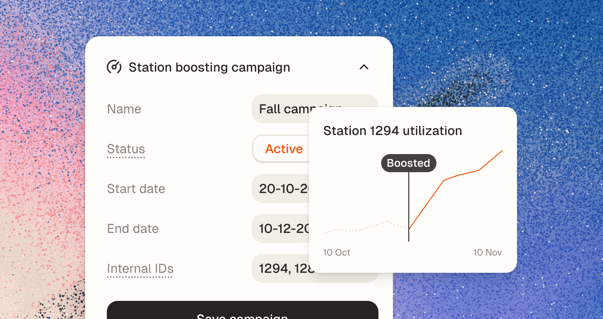

## Boosting-Gruppen von Stationen mit der Admin API verwalten

Wir haben über eine neue Admin API (`https://admin.chargetrip.io/graphql`) Unterstützung für die Verwaltung von Boosting-Gruppen von Stationen hinzugefügt, einschließlich Erstellen, Aktualisieren, Löschen, Auflisten und Abrufen einzelner Gruppen. Authentifizierte Clients können bis zu fünf aktive Boosting-Gruppen aus Schnell- und Ultraschnellladestationen definieren, um diese beim Routing zu priorisieren.

Das Dashboard wurde ebenfalls aktualisiert, sodass sich öffentliche Zugriffstoken für die Admin API sicher erzeugen, in der Vorschau anzeigen und löschen lassen. Weitere Informationen finden Sie in der [Admin-API-Referenz](/api-reference/admin).

### Echtzeit-Stationspreise im Tile Service

Die Stationseigenschaften des Tile Service (v2) enthalten nun Echtzeit-Ad-hoc-Ladepreise pro kWh, sodass Sie Stationen anhand ihres aktiven Energiepreises filtern können (`maximum_energy_price`).

- Preise werden serverseitig in die angeforderte ISO-4217-Währung umgerechnet, standardmäßig in EUR;
- Preise werden dynamisch pro Stunde ausgewertet, auf Basis der lokalen Zeitzone der jeweiligen Station;
- Derzeit nur für die Eco-Movement-Datenbank verfügbar. Weitere Datenbanken folgen. Wenden Sie sich für weitere Informationen an Ihren Customer Success Manager.

  
Verbesserungen

  - Die Warnungen auf Etappenebene wurden um `via_station_not_required_operator` erweitert. Sie zeigt an, wenn eine Via- oder Zielstation keinem der in den Routing-Einstellungen definierten erforderlichen oder verpflichtenden Betreiber angehört.
  - Die Struktur der Ausstattungsdaten wurde verbessert, indem das Feld `continent` in Adressdatensätzen von Ausstattungen anhand ihres Landes automatisch befüllt wird.
  - Die Validierungen bei Zielstationen mit strikter Fahrzeugkompatibilitätsprüfung wurden verbessert, um inkompatible Stopps zu verhindern.
  - Die Auslegung der Stoppdauer an Via-Stationen wurde von einem harten Maximum zu einer Mindeststoppdauer verbessert, sodass die Routing-Engine die gesamte Reisezeit durch eine Verlängerung der Stoppdauer optimieren kann.
  - Die für Nutzer sichtbaren Fehlermeldungen wurden verbessert, indem Ausrufezeichen durch Punkte ersetzt wurden, um professionellen Textrichtlinien zu entsprechen.

  
Fehlerbehebungen

  - Es wurde ein Problem behoben, bei dem das Anfordern alternativer Routen einen Fehler wegen eines nicht nullbaren Felds bei den Feldern charges oder distance der empfohlenen Route auslösen konnte.
  - Es wurde ein Problem behoben, bei dem das Filtern nach auf `null` gesetzten Betreiberpräferenzen der Station in der Query `getRouteStationsWithAmenities` einen Serverfehler verursachte.
  - Es wurde ein Problem behoben, bei dem Pagination-Beschreibungen bei `vehicleMakes` und `vehicleModels` fälschlicherweise angaben, dass die maximale Anzahl der pro Seite zurückgegebenen Elemente 10 statt 100 beträgt.
  - Es wurde ein Problem behoben, bei dem die Warnungen `risk_margin_soc_not_possible` und `final_soc_not_possible` fälschlicherweise zurückgegeben wurden, wenn Werte den sicheren Grenzen entsprachen oder der Ladezustand am Ziel nicht angegeben war.
  - Es wurde ein Problem behoben, bei dem das gleichzeitige Abfragen mehrerer Routen dazu führen konnte, dass das Feld recommended einer der Routen fälschlicherweise `null` zurückgab.
  - Es wurde ein Problem behoben, bei dem das Senden eines leeren Koordinaten-Arrays bei der Berechnung einer Isoline zu einem internen Serverfehler statt zu einem nutzerfreundlichen Validierungsfehler führte.
  - Es wurde ein Problem behoben, bei dem die Schema-Direktive `@ocpi` den Suffix *"This property is OCPI-compliant."* nicht an die Beschreibungen von GraphQL-Feldern anhängte.

