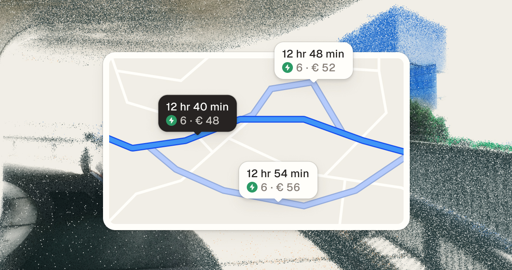

## Itinéraires alternatifs

Vous pouvez désormais demander des itinéraires alternatifs géographiquement différents en plus de l'itinéraire recommandé lors du calcul d'un itinéraire. Cela permet aux conducteurs et aux régulateurs d'évaluer d'autres trajets selon leurs préférences tout en conservant les mêmes contraintes de trajet. Vous pouvez demander jusqu'à 2 itinéraires alternatifs.

  
Correctifs

    - Correction d'un problème où la transmission de points de passage `via` vides, sans géométrie, emplacement ni ID de station, dans `createRoute` échouait silencieusement avec un statut `not_found` au lieu de renvoyer une erreur de validation `ROUTE_VIA_LOCATION_MISSING`.
    - Correction d'un problème dans `operatorList` où les requêtes utilisant des filtres de classement renvoyaient des résultats vides si le projet n'avait aucun pays exclu configuré, de sorte que les opérateurs correspondant aux préférences de classement sont désormais renvoyés correctement.

