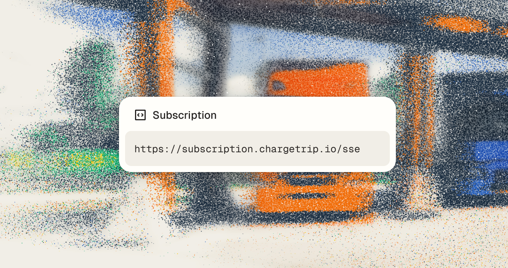

## Souscriptions v2

Nous avons lancé un nouveau service de souscriptions hébergé sous un domaine dédié (`subscription.chargetrip.io`), offrant une fiabilité accrue, des sous-protocoles standard et de nouveaux choix de transport.

- Connectez-vous via WebSocket sur `wss://subscription.chargetrip.io/ws` en utilisant le protocole moderne `graphql-transport-ws` ;
- Diffusez les souscriptions en HTTP avec les Server-Sent Events via `https://subscription.chargetrip.io/sse` ;
- Les connexions de souscription actives se ferment automatiquement lorsqu'une ressource atteint son état final (tel que `done`, `error` ou `not_found` pour les itinéraires et isolines, et `finished` ou `error` pour la navigation) ;
- Les charges utiles d'erreur suivent désormais des conventions d'erreur GraphQL cohérentes, avec des métadonnées d'extensions structurées.

### Groupes de boost de stations dans les requêtes de station

Nous avons étendu les requêtes de station afin d'indiquer si une station appartient à un groupe de boost actif.

- Ajout du champ `boosting_group_ids` au type `Station` dans les requêtes `station`, `stationList` et `stationAround` ;
- Renvoie un tableau des ID de groupes de boost actifs configurés pour votre projet, ou une liste vide (`[]`) si la station n'est pas actuellement boostée.

  
Correctifs

  
  - Correction d'un problème où des itinéraires comportant plusieurs traversées en ferry pouvaient aboutir à des arrivées dans des stations de recharge avec un état de charge négatif.
  - Correction d'un problème où le calcul d'itinéraires entre une origine et une destination très proches l'une de l'autre produisait une erreur de ligne invalide et échouait avec une réponse 404.

