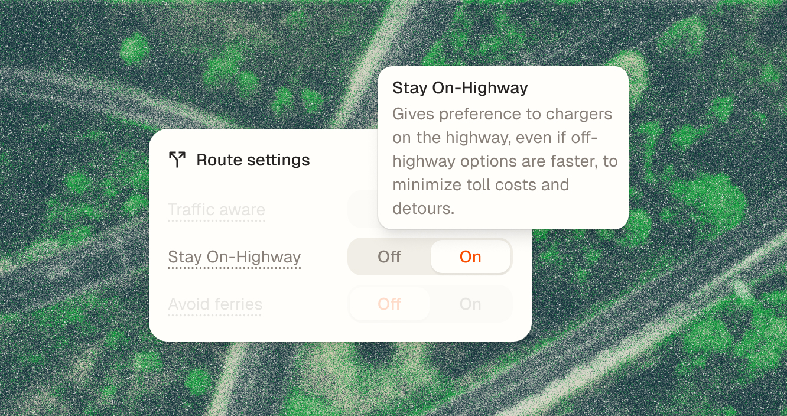

## Préférence de recharge sur autoroute

Cette nouvelle option donne la priorité aux bornes situées sur l'autoroute, même lorsque des stations hors autoroute pourraient offrir un itinéraire plus rapide.

  
Corrections

  - Correction d'un problème où des itinéraires qui repassaient par leur propre tracé pouvaient aboutir à un état de charge négatif.
  - Correction d'un problème où la durée de recharge à l'arrêt final était calculée de manière incorrecte lors de l'utilisation du mode de recharge `OPTIMIZE_TRAVEL_TIME` combiné à un état de charge final personnalisé.

