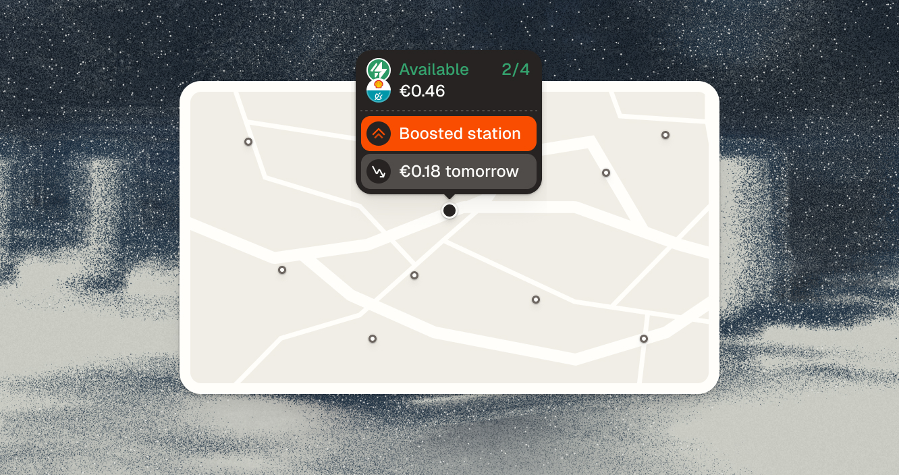

## Influencez les itinéraires avec le boost de stations

Pour les entreprises qui souhaitent maximiser l'utilisation de leur réseau, honorer des accords avec des partenaires ou orienter les conducteurs vers des stations de recharge spécifiques à forte marge, le boost de stations offre un moyen simple d'influencer les décisions de calcul d'itinéraire. Disponible en Alpha, cette fonctionnalité vous donne un contrôle direct sur la manière dont des lieux de recharge précis sont priorisés, sans complexité opérationnelle inutile.

- Groupes de clients ciblés : créez jusqu'à 5 groupes distincts par environnement (avec jusqu'à 50 stations spécifiques par groupe) pour mener des campagnes régionales ou temporelles ciblées.

Si vous souhaitez tester cette fonctionnalité et commencer à orienter le volume vers du matériel prioritaire, contactez votre Customer Success Manager pour gérer votre configuration.

### État de charge maximal de recharge configurable et limites de batterie étendues
Les conducteurs peuvent désormais configurer l'état de charge (SoC) maximal des arrêts de recharge entre 80 % et 100 %, et planifier des trajets nécessitant des niveaux de batterie restants plus élevés à l'arrivée.

- Transmettez `maximum_state_of_charge` (80 à 100 %) dans `createRoute` (`RouteVehicleChargingInput`). Lorsqu'il est défini, les véhicules peuvent se recharger au-delà du plafond par défaut de 80 % lors des arrêts planifiés ou non planifiés, dans les modes `ALWAYS_TO_MAX_CHARGE` et `OPTIMIZE_TRAVEL_TIME` ;
- Configurez `final_state_of_charge` jusqu'à 80 % de la capacité de la batterie du véhicule (contre 60 % auparavant) ;
- Ajout de deux nouveaux avertissements de SoC au niveau du tronçon : `risk_margin_soc_not_possible` lorsque le SoC d'arrivée attendu est inférieur à la marge de risque de sécurité, et `final_soc_below_risk_margin` lorsque le SoC final demandé est inférieur à la marge de risque de sécurité.

  
Améliorations

  - Ajout de filtres de type tableau `type` et `region` à `vehicleMakes` (`VehicleMakesFilter`), permettant aux clients de filtrer les marques qui proposent des types de véhicules spécifiques ou qui opèrent dans des régions géographiques données.
  - Ajout de `model_count` à `VehicleMake` et de `vehicle_count` à `VehicleModel` pour exposer en temps réel le nombre de modèles accessibles par marque et de véhicules par modèle.
  - Mise en place d'arguments de pagination par curseur (`first` et `after`) ainsi que de `total_count` et `page_info` sur la requête `vehicleMakes`.
  - Mise à jour des requêtes `vehicleMakes` et de véhicules pour renvoyer les logos de marque propres à un pays lorsqu'un filtre de pays est fourni, avec repli sur les images globales lorsque les ressources localisées ne sont pas configurées.

  
Correctifs

  - Correction d'un problème dans `vehicleList` où le filtrage par nom de marque échouait après l'introduction des ID de marque, avec rétablissement de la rétrocompatibilité pour que `filter.make` accepte à la fois les ID de marque et les noms de marque.
  - Correction d'un problème où des itinéraires débutant avec un état de charge initial inférieur à la marge de risque de sécurité (`initialSOC < safeRiskMargin`) roulaient jusqu'à atteindre 0 % de batterie au lieu de se diriger vers la station de recharge disponible la plus proche.
  - Correction d'un problème où la somme des durées des sections de tronçon individuelles ne correspondait pas aux durées totales de conduite (`durations.driving`) dans les détails de l'itinéraire.

