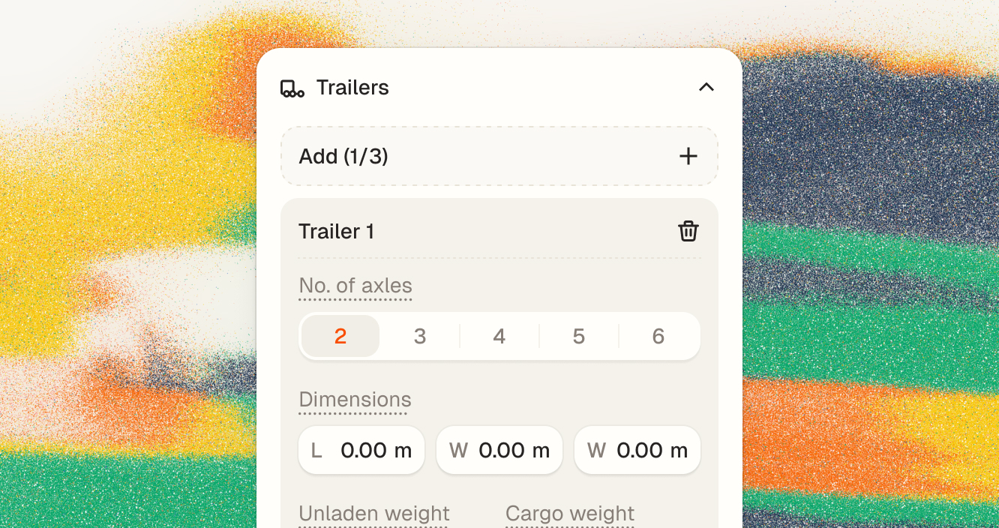

## Itinéraires camion

Nous avons officiellement lancé notre moteur d'itinéraires camion dédié côté backend. Accessible via un tout nouvel ensemble de requêtes et de mutations, cette fonctionnalité d'API autonome prend en compte les limites de poids, les hauteurs libres et les modèles de consommation d'énergie propres aux camions pour construire des itinéraires professionnels fiables pour les véhicules électriques lourds.

  
Améliorations

  - Amélioration de la validation et du signalement des erreurs de diagnostic lors de la spécification de stations de recharge via dans createRoute, avec des codes d'erreur explicites (`ROUTE_STATION_OUT_OF_SERVICE`, `ROUTE_STATION_INVALID_CHARGER` et `ROUTE_STATION_INVALID_SPEED` affiné) lorsque la recharge est impossible, et introduction de l'avertissement de tronçon via_station_below_minimum_power lorsque les connecteurs disponibles passent sous le seuil minimum_power demandé.

  
Corrections

  - Correction d'un problème où les durées totales de conduite et de trajet (`durations.driving` et `durations.total`) des itinéraires recommandés et alternatifs omettaient les retards dus à la congestion lorsque `traffic_aware` était activé.
  - Correction d'un problème où des itinéraires se terminant à une station de recharge enregistraient une durée de recharge erronée sur le dernier tronçon et ajoutaient un arrêt de recharge supplémentaire au total `charges` de l'itinéraire.
  - Correction d'un problème où le filtrage de `vehicleList` par des chaînes `make` ou `model` contenant des caractères spéciaux (tels que `Lynk&Co`, `e.GO`, `ID.7` ou `N°4 E-Tense`) renvoyait des résultats vides.
  - Correction d'un problème dans `amenityList` où les résultats filtrés de recherche de points d'intérêt ne correspondaient pas au nombre total d'équipements de la station.

