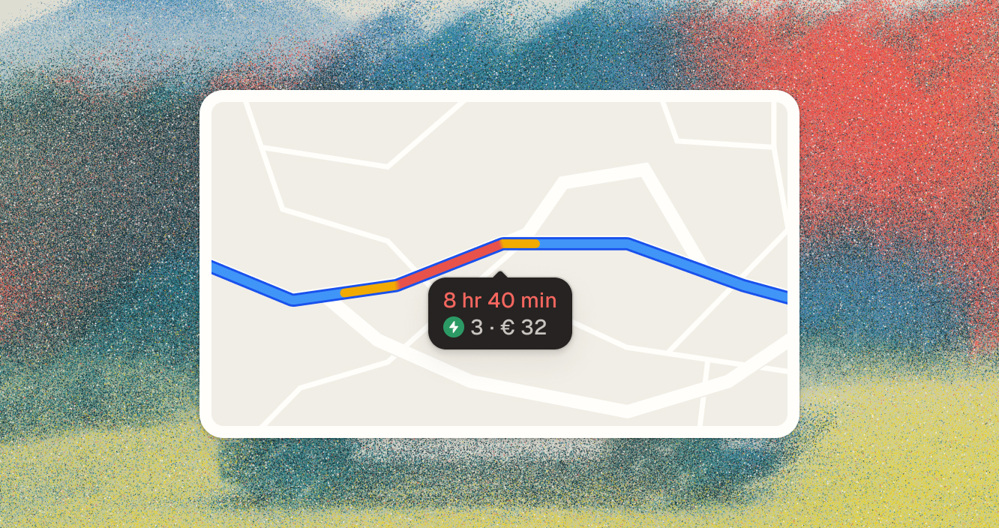

## Trafic

Activez le calcul d'itinéraire tenant compte du trafic pour prendre en compte l'impact global du trafic lors du calcul des itinéraires. Tenir compte du trafic et des incidents tout en optimisant la recharge a longtemps été considéré comme le Graal de l'optimisation d'itinéraire pour véhicules électriques. Lorsqu'elle est activée, la réponse d'itinéraire inclut :

- Les **segments** de l'itinéraire touchés par le trafic ;
- Le **niveau de congestion** sur ces segments ;
- Le **retard** ajouté à la durée totale de l'itinéraire.

Cela fournit une estimation plus réaliste du temps de trajet lorsque les conditions de circulation affectent l'itinéraire et vous permet de proposer à vos clients des itinéraires globalement optimisés, prêts pour la navigation guidée.

### Avertissements d'itinéraire

Le calcul d'itinéraire est souvent un processus au mieux de ses possibilités. Il arrive que le moteur de calcul d'itinéraire ne puisse pas satisfaire pleinement toutes les conditions demandées. Les avertissements aident à expliquer pourquoi un itinéraire peut différer de la demande initiale. Par exemple :

- **Opérateurs indisponibles** : les stations des opérateurs de recharge préférés ne sont pas disponibles pour ce tronçon d'itinéraire.
- **Contraintes** : l'état de charge final demandé n'a pas pu être atteint.

Les avertissements permettent aux équipes front-end de fournir aux conducteurs des retours utiles ou aux ingénieurs de mieux comprendre le comportement du calcul d'itinéraire. Cela facilite la compréhension des résultats et le diagnostic des cas limites.

  
Améliorations

    - Assouplissement de la validation du classement des opérateurs dans `createRoute` : si des préférences d'opérateurs (préférés ou obligatoires) sont demandées sans niveaux fournis dans la requête ni configurés dans les paramètres du projet, le calcul de l'itinéraire réussit désormais sans priorisation des opérateurs et renvoie un avertissement non bloquant `OPERATOR_PREFERENCES_NOT_FOUND` dans getRoute (également documenté via /public/warnings).

  
Correctifs

  - Correction d'un problème où la recherche ou le filtrage de la liste de véhicules (vehicleList) par des chaînes contenant des parenthèses (comme des noms de marque ou de modèle de véhicule) provoquait des échecs d'analyse de la requête et renvoyait une erreur interne du serveur.

