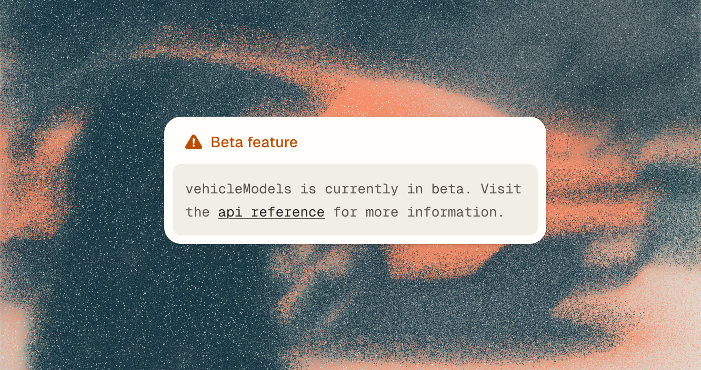

## Avertissements d'API expérimentale et d'obsolescence

Nous avons introduit des avertissements de cycle de vie dans les extensions de réponse GraphQL pour informer les développeurs chaque fois qu'une opération ou un champ demandé est en alpha, en bêta ou programmé pour obsolescence. Cela offre une visibilité directe sur la maturité des fonctionnalités et les obsolescences à venir, sans perturber les réponses de l'API.

Nouveautés :

- **Notifications de cycle de vie** : recevez des alertes structurées sous `extensions.warnings` chaque fois que votre requête touche des éléments du schéma marqués `@experimental(stage: "alpha")`, `@experimental(stage: "beta")` ou `@chargetripdeprecated` ;
- **Diffusion cohérente** : les avertissements sont inclus dans toutes les réponses, que l'opération réussisse ou renvoie des erreurs.

  
Améliorations

    - Extension de `createIsoline` pour prendre en charge des conditions météo personnalisées (`temperature`, `air_pressure` et `solar_irradiance`) en plus des préréglages standard (`summer`, `winter`, `actual`) via la nouvelle entrée `weather`, avec obsolescence de l'entrée `season`.
    - Ajout d'avertissements sur l'état d'exploitation des stations au niveau du tronçon d'itinéraire (`station_closed`, `station_closing_soon` et `station_unknown_open_hours`) et affinement de `station_limited_open_hours` pour avertir les conducteurs lorsqu'une station sur leur itinéraire peut être fermée ou avoir des horaires d'ouverture limités ou inconnus à leur arrivée.
    - Standardisation des annotations de schéma en remplaçant les descriptions textuelles `[BETA]` codées en dur par la directive formelle `@experimental(stage: "beta")` dans les schémas GraphQL Isoline, Routing V2 et Navigation.

  
Correctifs

    - Correction d'un problème dans getRoute où savings.money renvoyait null au lieu de 0 sur les itinéraires BEV lorsqu'aucune économie monétaire n'était réalisée.

