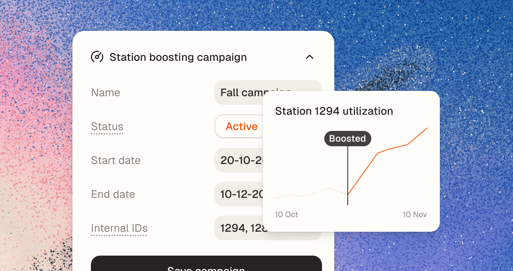

## Gérez les groupes de boost de stations avec l'API Admin

Nous avons ajouté la prise en charge de la gestion des groupes de boost de stations, notamment la création, la mise à jour, la suppression, la liste et la récupération individuelle, via une nouvelle API Admin (`https://admin.chargetrip.io/graphql`). Les clients authentifiés peuvent définir jusqu'à cinq groupes de boost actifs de stations de recharge rapide et ultra-rapide afin de les prioriser dans le calcul d'itinéraire.

Le tableau de bord a également été mis à jour pour permettre de générer, prévisualiser et supprimer en toute sécurité des jetons d'accès publics à l'API Admin. Consultez la [référence de l'API Admin](/api-reference/admin) pour plus d'informations.

### Prix des stations en temps réel dans le Tile Service

Les propriétés de station du Tile Service (v2) incluent désormais les prix de recharge ad hoc en temps réel par kWh, ce qui vous permet de filtrer les stations selon leur prix actif de l'énergie (`maximum_energy_price`).

- Les prix sont convertis côté serveur dans la devise ISO-4217 demandée, EUR par défaut ;
- Les prix sont évalués dynamiquement par heure, selon le fuseau horaire local de chaque station ;
- Actuellement disponible uniquement pour la base de données Eco-Movement. Les autres bases suivront. Contactez votre Customer Success Manager pour plus d'informations.

  
Améliorations

  - Amélioration des avertissements au niveau du tronçon avec l'ajout de `via_station_not_required_operator`, qui indique qu'une station via ou de destination n'appartient à aucun des opérateurs requis ou obligatoires définis dans les paramètres de calcul d'itinéraire.
  - Amélioration de la structure des données d'équipements en renseignant automatiquement le champ `continent` des adresses d'équipements à partir de leur pays.
  - Amélioration des validations sur les stations de destination avec des contrôles stricts de compatibilité des véhicules afin d'éviter les arrêts incompatibles.
  - Amélioration de l'interprétation des durées d'arrêt aux stations via, qui passent d'un maximum strict à une durée d'arrêt minimale, ce qui permet au moteur de calcul d'itinéraire d'optimiser le temps de trajet global en prolongeant la durée de l'arrêt.
  - Amélioration des messages d'erreur destinés aux utilisateurs en remplaçant les points d'exclamation par des points, conformément aux consignes de rédaction professionnelle.

  
Correctifs

  - Correction d'un problème où la demande d'itinéraires alternatifs pouvait déclencher une erreur de champ non nullable sur les champs charges ou distance de l'itinéraire recommandé.
  - Correction d'un problème où le filtrage par préférences d'opérateurs de station définies sur `null` dans la requête `getRouteStationsWithAmenities` provoquait une erreur serveur.
  - Correction d'un problème où les descriptions de pagination indiquaient à tort que le nombre maximal d'éléments renvoyés par page était de 10 au lieu de 100 sur `vehicleMakes` et `vehicleModels`.
  - Correction d'un problème où les avertissements `risk_margin_soc_not_possible` et `final_soc_not_possible` étaient renvoyés à tort lorsque les valeurs étaient égales aux limites de sécurité ou que le SoC final n'était pas spécifié.
  - Correction d'un problème où l'interrogation simultanée de plusieurs itinéraires pouvait faire renvoyer à tort `null` au champ recommended de l'un des itinéraires.
  - Correction d'un problème où l'envoi d'un tableau de coordonnées vide lors du calcul d'une isoline provoquait une erreur interne du serveur au lieu d'une erreur de validation compréhensible.
  - Correction d'un problème où la directive de schéma `@ocpi` n'ajoutait pas le suffixe *"This property is OCPI-compliant."* aux descriptions des champs GraphQL.

