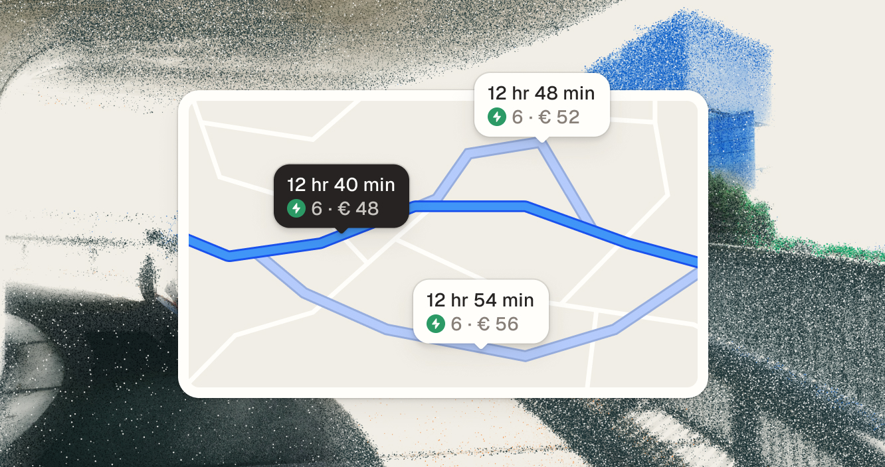

## Percorsi alternativi

Ora puoi richiedere percorsi alternativi geograficamente diversi insieme al percorso consigliato durante il calcolo del percorso. In questo modo conducenti e dispatcher possono valutare percorsi alternativi in base alle proprie preferenze, mantenendo gli stessi vincoli del viaggio. Puoi specificare fino a 2 percorsi alternativi.

  
Correzioni

    - Risolto un problema per cui fornire in `createRoute` waypoint `via` vuoti, senza geometria, posizione o ID di stazione, falliva silenziosamente con uno stato `not_found` invece di restituire un errore di validazione `ROUTE_VIA_LOCATION_MISSING`.
    - Risolto un problema in `operatorList` per cui le query che utilizzavano filtri di classifica restituivano risultati vuoti se il progetto non aveva paesi esclusi configurati, garantendo che i gestori corrispondenti alle preferenze di classifica vengano restituiti correttamente.

