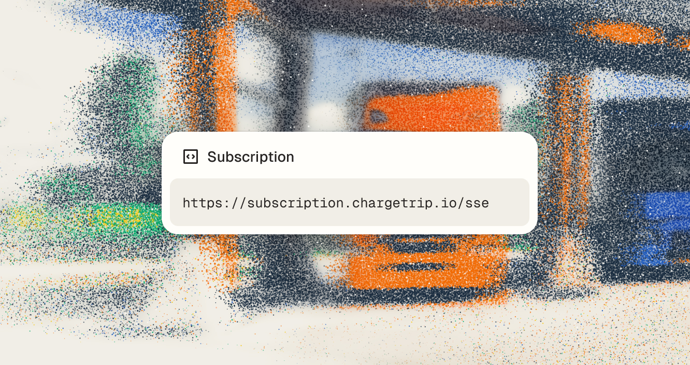

## Subscription v2

Abbiamo lanciato un nuovo servizio di subscription ospitato su un dominio dedicato (`subscription.chargetrip.io`), che offre maggiore affidabilità, sottoprotocolli standard e nuove opzioni di trasporto.

- Connettiti tramite WebSocket su `wss://subscription.chargetrip.io/ws` utilizzando il moderno protocollo `graphql-transport-ws`;
- Ricevi le subscription in streaming via HTTP con i Server-Sent Events tramite `https://subscription.chargetrip.io/sse`;
- Le connessioni di subscription attive si chiudono automaticamente quando una risorsa raggiunge il suo stato finale (come `done`, `error` o `not_found` per percorsi/isodistanze, e `finished` o `error` per la navigazione);
- I payload di errore ora seguono convenzioni di errore GraphQL coerenti, con metadati di estensione strutturati.

### Gruppi di boosting delle stazioni nelle query delle stazioni

Abbiamo esteso le query delle stazioni per offrire visibilità sull'appartenenza di una stazione a un gruppo di boosting attivo.

- Aggiunto il campo `boosting_group_ids` al tipo `Station` nelle query `station`, `stationList` e `stationAround`;
- Restituisce un array degli ID dei gruppi di boosting attivi configurati per il tuo progetto, oppure una lista vuota (`[]`) se la stazione non è attualmente in boosting.

  
Correzioni

  
  - Risolto un problema per cui i percorsi con più collegamenti in traghetto potevano portare ad arrivare alle stazioni di ricarica con uno stato di carica negativo.
  - Risolto un problema per cui il calcolo di percorsi tra punti di origine e destinazione molto vicini tra loro produceva un errore di line string non valida e falliva con una risposta 404.

