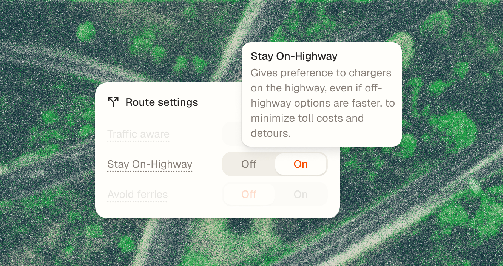

## Preferenza di ricarica in autostrada

Questa nuova opzione dà priorità ai punti di ricarica situati in autostrada, anche negli scenari in cui le stazioni fuori dall'autostrada potrebbero offrire un percorso più veloce.

  
Correzioni

  - Risolto un problema per cui i percorsi che ripercorrevano il proprio tragitto potevano finire con uno stato di carica negativo.
  - Risolto un problema per cui il tempo di ricarica all'ultima tappa veniva calcolato in modo errato usando la modalità di ricarica `OPTIMIZE_TRAVEL_TIME` combinata con uno stato di carica finale personalizzato.

