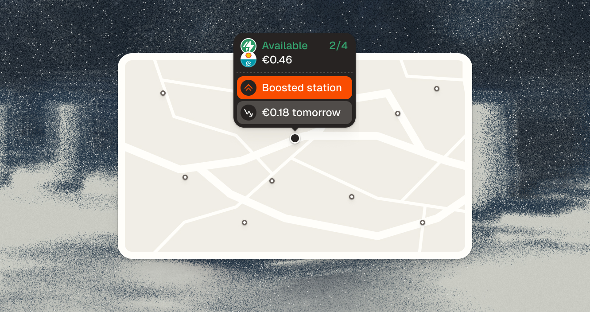

## Influenza i percorsi con lo Station Boosting

Per le aziende che vogliono massimizzare l'utilizzo della rete, rispettare gli accordi con i partner o guidare i conducenti verso specifiche stazioni di ricarica ad alto margine, lo Station Boosting offre un modo semplice per influenzare le decisioni di instradamento. Disponibile in Alpha, questa funzionalità ti dà il controllo diretto su come vengono prioritizzate specifiche postazioni di ricarica, senza aggiungere complessità operativa non necessaria.

- Gruppi di client mirati: crea fino a 5 gruppi distinti per ambiente (con fino a 50 stazioni specifiche per gruppo) per eseguire campagne regionali o basate sul tempo.

Se vuoi testare questa funzionalità e iniziare a indirizzare i volumi verso l'hardware ad alta priorità, contatta il tuo Customer Success Manager per gestire la tua configurazione.

### SoC massimo di ricarica configurabile e limiti della batteria estesi
I conducenti possono ora configurare lo stato di carica (SoC) massimo per le tappe di ricarica tra l'80% e il 100% e pianificare viaggi che richiedono livelli di batteria residua più alti all'arrivo.

- Passa `maximum_state_of_charge` (80–100%) in `createRoute` (`RouteVehicleChargingInput`). Se impostato, i veicoli possono ricaricare oltre il limite predefinito dell'80% durante le tappe pianificate o non pianificate, sia nella modalità `ALWAYS_TO_MAX_CHARGE` sia in `OPTIMIZE_TRAVEL_TIME`;
- Configura `final_state_of_charge` fino all'80% della capacità della batteria del veicolo (aumentato dal 60%);
- Aggiunti due nuovi avvisi di SoC per tratta: `risk_margin_soc_not_possible` quando il SoC previsto all'arrivo scende sotto il margine di rischio di sicurezza, e `final_soc_below_risk_margin` quando il SoC finale richiesto scende sotto il margine di rischio di sicurezza.

  
Miglioramenti

  - Aggiunti i filtri array `type` e `region` a `vehicleMakes` (`VehicleMakesFilter`), che consentono ai client di filtrare i marchi che offrono specifici tipi di veicolo o operano in determinate regioni geografiche.
  - Aggiunti `model_count` a `VehicleMake` e `vehicle_count` a `VehicleModel` per esporre i conteggi in tempo reale dei modelli accessibili per marca e dei veicoli per modello.
  - Implementati gli argomenti di paginazione basata su cursore (`first` e `after`) insieme a `total_count` e `page_info` nella query `vehicleMakes`.
  - Aggiornate le query `vehicleMakes` e dei veicoli per restituire i loghi dei marchi specifici per paese quando viene fornito un filtro per paese, tornando alle immagini globali quando le risorse localizzate non sono configurate.

  
Correzioni

  - Risolto un problema in `vehicleList` per cui il filtro per nome della marca falliva dopo l'introduzione degli ID delle marche, ripristinando la retrocompatibilità in modo che `filter.make` accetti sia ID sia nomi delle marche.
  - Risolto un problema per cui i percorsi che partivano con uno stato di carica iniziale inferiore al margine di rischio di sicurezza (`initialSOC < safeRiskMargin`) venivano percorsi fino a raggiungere lo 0% di batteria invece di instradare verso la stazione di ricarica disponibile più vicina.
  - Risolto un problema per cui la somma delle durate delle singole sezioni delle tratte non corrispondeva alle durate totali di guida (`durations.driving`) nei dettagli del percorso.

