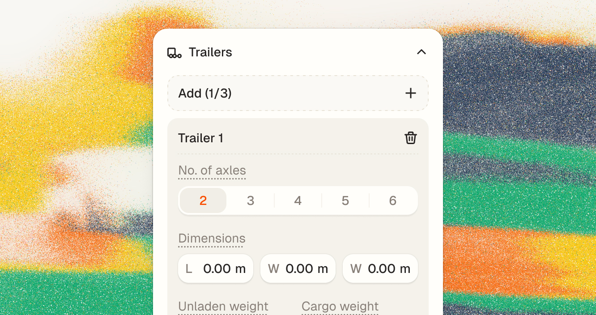

## Percorsi per camion

Abbiamo lanciato ufficialmente il nostro motore dedicato di calcolo dei percorsi per camion sul backend. Accessibile tramite un nuovissimo set di query e mutation, questa funzionalità API autonoma tiene conto di limiti di peso, altezze libere e modelli di consumo energetico specifici dei camion per costruire percorsi commerciali affidabili per veicoli elettrici pesanti.

  
Miglioramenti

  - Migliorati la validazione e la segnalazione diagnostica degli errori quando si specificano stazioni di ricarica via in createRoute, restituendo codici di errore espliciti (`ROUTE_STATION_OUT_OF_SERVICE`, `ROUTE_STATION_INVALID_CHARGER` e il perfezionato `ROUTE_STATION_INVALID_SPEED`) quando la ricarica non è possibile, e introducendo l'avviso di tratta via_station_below_minimum_power quando i connettori disponibili scendono sotto la soglia minimum_power richiesta.

  
Correzioni

  - Risolto un problema per cui le durate totali di guida e di viaggio (`durations.driving` e `durations.total`) sui percorsi consigliati e alternativi omettevano i ritardi dovuti alla congestione quando `traffic_aware` era abilitato.
  - Risolto un problema per cui i percorsi che terminavano presso una stazione di ricarica registravano una durata di ricarica errata nell'ultima tratta e aggiungevano una sosta di ricarica extra al conteggio totale `charges` del percorso.
  - Risolto un problema per cui il filtro di `vehicleList` per stringhe `make` o `model` contenenti caratteri speciali (come `Lynk&Co`, `e.GO`, `ID.7` o `N°4 E-Tense`) restituiva risultati vuoti.
  - Risolto un problema in `amenityList` per cui i risultati filtrati della ricerca di POI non corrispondevano al conteggio totale dei servizi della stazione.

