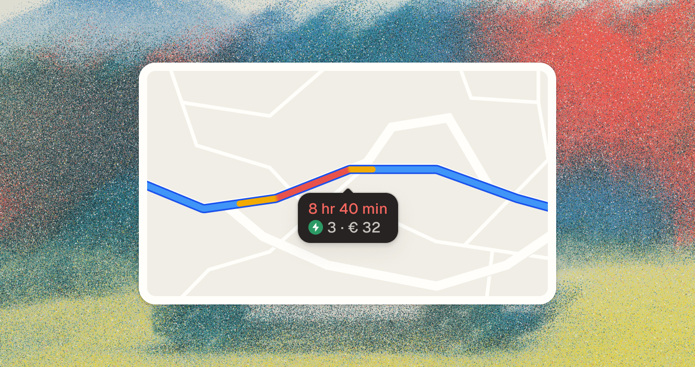

## Traffico

Abilita l'instradamento che tiene conto del traffico, considerando l'impatto globale del traffico nel calcolo dei percorsi. Tenere conto di traffico e incidenti ottimizzando al tempo stesso la ricarica è da tempo considerato il Santo Graal dell'ottimizzazione dei percorsi per veicoli elettrici. Quando è abilitato, la risposta del percorso include:

- **Segmenti** del percorso interessati dal traffico;
- **Livello di congestione** su quei segmenti;
- **Ritardo** aggiunto alla durata totale del percorso.

Questo fornisce una stima più realistica del tempo di viaggio quando le condizioni del traffico influenzano il percorso e ti consente di offrire ai tuoi clienti percorsi ottimizzati a livello globale, pronti per la navigazione turn-by-turn.

### Avvisi sul percorso

L'instradamento è spesso un processo best-effort. A volte il motore di calcolo non riesce a soddisfare pienamente tutte le condizioni richieste. Gli avvisi aiutano a spiegare perché un percorso può differire dalla richiesta originale. Alcuni esempi:

- **Operatori non disponibili**: le stazioni con gli operatori di ricarica preferiti non sono disponibili per questa tratta del percorso.
- **Vincoli**: non è stato possibile raggiungere lo stato di carica finale richiesto.

Gli avvisi permettono ai team front-end di mostrare feedback utili ai conducenti o di offrire agli ingegneri una comprensione più approfondita del comportamento dell'instradamento. Questo rende più semplice interpretare i risultati dell'instradamento e risolvere i casi limite.

  
Miglioramenti

    - Resa meno restrittiva la validazione della classifica degli operatori in `createRoute`: se vengono richieste preferenze sugli operatori (preferiti o obbligatori) senza livelli forniti nella richiesta o configurati nelle impostazioni del progetto, il calcolo del percorso ora riesce senza dare priorità agli operatori e restituisce in getRoute un avviso non bloccante `OPERATOR_PREFERENCES_NOT_FOUND` (documentato anche tramite /public/warnings).

  
Correzioni

  - Risolto un problema per cui la ricerca o il filtro dell'elenco veicoli (vehicleList) con stringhe contenenti parentesi (come nomi di marca o modello del veicolo) causava errori di parsing della query e restituiva un errore interno del server.

