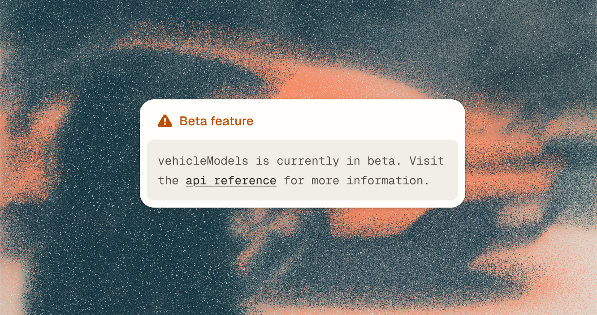

## Avvisi API per funzionalità sperimentali e deprecazioni

Abbiamo introdotto avvisi sul ciclo di vita nelle estensioni di risposta GraphQL per informare gli sviluppatori ogni volta che un'operazione o un campo richiesto è in alpha, beta o programmato per la deprecazione. Questo offre visibilità diretta sulla maturità delle funzionalità e sulle prossime deprecazioni senza interrompere le risposte dell'API.

Novità:

- **Notifiche sul ciclo di vita**: ricevi avvisi strutturati in `extensions.warnings` ogni volta che la tua richiesta coinvolge elementi dello schema contrassegnati con `@experimental(stage: "alpha")`, `@experimental(stage: "beta")` o `@chargetripdeprecated`;
- **Consegna coerente**: gli avvisi sono inclusi in tutte le risposte, indipendentemente dal fatto che l'operazione riesca o restituisca errori.

  
Miglioramenti

    - Esteso `createIsoline` per supportare condizioni meteo personalizzate (`temperature`, `air_pressure` e `solar_irradiance`) insieme ai preset standard (`summer`, `winter`, `actual`) tramite il nuovo input `weather`, deprecando l'input `season`.
    - Aggiunti avvisi sullo stato operativo delle stazioni a livello di tratta del percorso (`station_closed`, `station_closing_soon` e `station_unknown_open_hours`) e perfezionato `station_limited_open_hours` per avvisare i conducenti quando una stazione sul loro percorso potrebbe essere chiusa o avere orari di apertura limitati/sconosciuti all'arrivo.
    - Standardizzate le annotazioni degli schemi sostituendo le descrizioni testuali `[BETA]` hardcoded con la direttiva formale `@experimental(stage: "beta")` negli schemi GraphQL di Isoline, Routing V2 e Navigation.

  
Correzioni

    - Risolto un problema in getRoute per cui savings.money restituiva null invece di 0 sui percorsi BEV quando non veniva accumulato alcun risparmio monetario.

