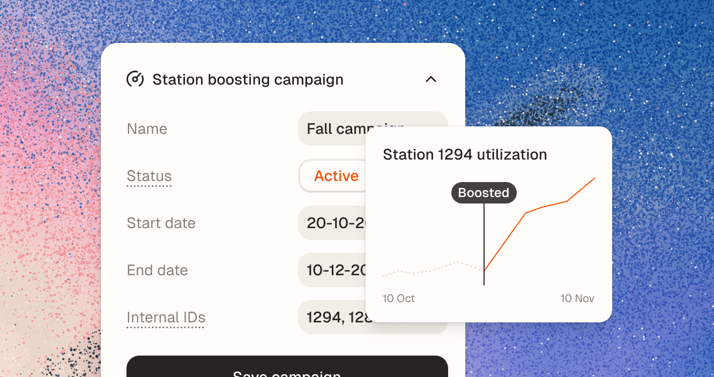

## Gestisci i gruppi di boosting delle stazioni con l'Admin API

Abbiamo aggiunto il supporto per la gestione dei gruppi di boosting delle stazioni, inclusi creazione, aggiornamento, eliminazione, elenco e recupero del singolo gruppo, tramite una nuova Admin API (`https://admin.chargetrip.io/graphql`). I client autenticati possono definire fino a cinque gruppi di boosting attivi di stazioni di ricarica rapida e ultra-rapida per dare loro priorità nel routing.

La dashboard è stata inoltre aggiornata per supportare in modo sicuro la generazione, l'anteprima e l'eliminazione dei token di accesso pubblici all'Admin API. Consulta il [riferimento dell'Admin API](/api-reference/admin) per maggiori informazioni.

### Prezzi delle stazioni in tempo reale nel Tile Service

Le proprietà delle stazioni del Tile Service (v2) ora includono i prezzi di ricarica ad hoc in tempo reale per kWh, permettendoti di filtrare le stazioni in base al loro prezzo dell'energia attivo (`maximum_energy_price`).

- I prezzi vengono convertiti lato server nella valuta ISO-4217 richiesta, con EUR come valore predefinito;
- I prezzi vengono valutati dinamicamente ora per ora, in base al fuso orario locale di ciascuna stazione;
- Attualmente disponibile solo per il database Eco-Movement. Gli altri database seguiranno. Contatta il tuo Customer Success Manager per maggiori informazioni.

  
Miglioramenti

  - Migliorati gli avvisi a livello di tratta con l'aggiunta di `via_station_not_required_operator`, che indica quando una stazione via o di destinazione non appartiene a nessuno dei gestori richiesti o obbligatori definiti nelle impostazioni di routing.
  - Migliorata la struttura dei dati dei servizi popolando automaticamente il campo `continent` nei record di indirizzo dei servizi in base al loro paese.
  - Migliorate le validazioni sulle stazioni di destinazione con controlli rigorosi di compatibilità del veicolo per evitare soste incompatibili.
  - Migliorata l'interpretazione delle durate di sosta alle stazioni via, da massimo rigido a durata minima di sosta, permettendo al motore di routing di ottimizzare il tempo di viaggio complessivo estendendo la durata della sosta.
  - Migliorati i messaggi di errore rivolti all'utente sostituendo i punti esclamativi con punti fermi, in linea con le linee guida di scrittura professionale.

  
Correzioni

  - Risolto un problema per cui la richiesta di percorsi alternativi poteva generare un errore di campo non nullable sui campi charges o distance del percorso consigliato.
  - Risolto un problema per cui il filtraggio per preferenze dei gestori delle stazioni impostate su `null` nella query `getRouteStationsWithAmenities` causava un errore del server.
  - Risolto un problema per cui le descrizioni della paginazione indicavano erroneamente che il numero massimo di elementi restituiti per pagina era 10 invece di 100 in `vehicleMakes` e `vehicleModels`.
  - Risolto un problema per cui gli avvisi `risk_margin_soc_not_possible` e `final_soc_not_possible` venivano restituiti erroneamente quando i valori erano uguali ai limiti di sicurezza o lo stato di carica finale non era specificato.
  - Risolto un problema per cui interrogare più percorsi contemporaneamente poteva far restituire erroneamente `null` dal campo recommended di uno dei percorsi.
  - Risolto un problema per cui l'invio di un array di coordinate vuoto durante il calcolo di un'isodistanza causava un errore interno del server invece di un errore di validazione comprensibile.
  - Risolto un problema per cui la direttiva di schema `@ocpi` non aggiungeva il suffisso *"This property is OCPI-compliant."* alle descrizioni dei campi GraphQL.

