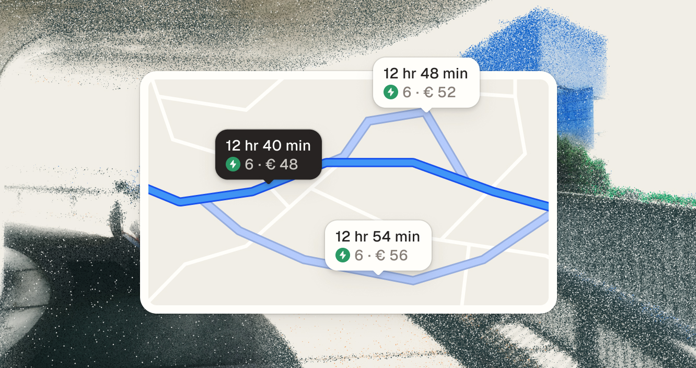

## Alternatif rotalar

Artık rota hesaplaması sırasında önerilen rotanın yanı sıra coğrafi olarak farklı alternatif rotalar da isteyebilirsiniz. Bu sayede sürücüler ve sevkiyat görevlileri, aynı yolculuk kısıtlarını koruyarak alternatif güzergahları kendi tercihlerine göre değerlendirebilir. En fazla 2 alternatif rota belirtebilirsiniz.

  
Düzeltmeler

    - `createRoute` içinde geometri, konum veya istasyon ID'si olmayan boş `via` ara noktaları sağlandığında, `ROUTE_VIA_LOCATION_MISSING` doğrulama hatası döndürmek yerine `not_found` durumuyla sessizce başarısız olunan sorun düzeltildi.
    - `operatorList` içinde, projede hariç tutulan ülke yapılandırılmamışsa sıralama filtreleri kullanan sorguların boş sonuç döndürdüğü sorun düzeltildi; böylece sıralama tercihlerine uyan operatörler doğru şekilde döndürülüyor.

