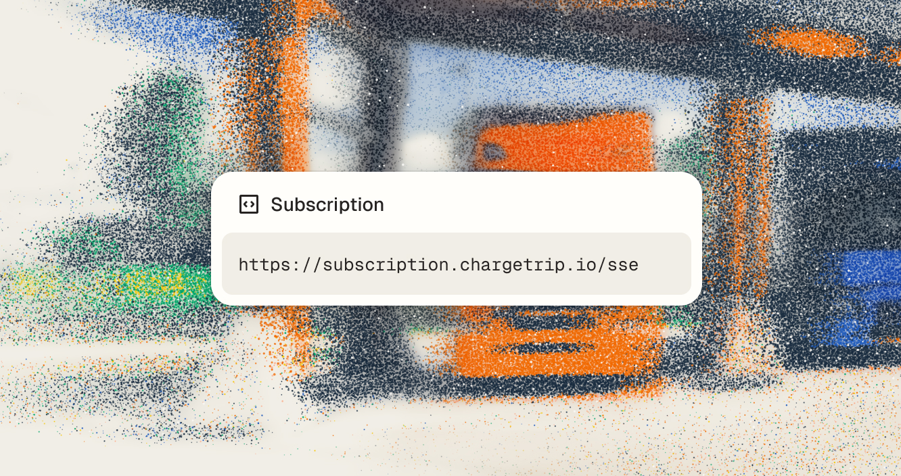

## Subscriptions v2

Özel bir alan adı (`subscription.chargetrip.io`) altında barındırılan yeni bir abonelik hizmetini kullanıma sunduk. Bu hizmet, gelişmiş güvenilirlik, standart alt protokoller ve yeni aktarım seçenekleri sunar.

- Modern `graphql-transport-ws` protokolünü kullanarak `wss://subscription.chargetrip.io/ws` üzerinden WebSocket ile bağlanın;
- Abonelikleri `https://subscription.chargetrip.io/sse` üzerinden Server-Sent Events kullanarak HTTP üzerinden akışa alın;
- Bir kaynak nihai durumuna ulaştığında (rotalar/izolinler için `done`, `error` veya `not_found`, navigasyon için `finished` veya `error` gibi) etkin abonelik bağlantıları otomatik olarak kapanır;
- Hata yükleri artık yapılandırılmış uzantı meta verileriyle tutarlı GraphQL hata kurallarını izliyor.

### İstasyon sorgularında istasyon öne çıkarma grupları

Bir istasyonun etkin bir öne çıkarma grubuna ait olup olmadığını görebilmek için istasyon sorgularını genişlettik.

- `station`, `stationList` ve `stationAround` sorgularında `Station` türüne `boosting_group_ids` alanı eklendi;
- Projeniz için yapılandırılmış etkin öne çıkarma grubu ID'lerinden oluşan bir dizi döndürür; istasyon şu anda öne çıkarılmıyorsa boş bir liste (`[]`) döndürür.

  
Düzeltmeler

  
  - Birden fazla feribot bağlantısı içeren rotaların, şarj istasyonlarına negatif şarj durumuyla varan rotalarla sonuçlanabildiği sorun düzeltildi.
  - Birbirine çok yakın başlangıç ve varış noktaları arasında rota hesaplamanın geçersiz bir çizgi dizisi hatası ürettiği ve 404 yanıtıyla başarısız olduğu sorun düzeltildi.

