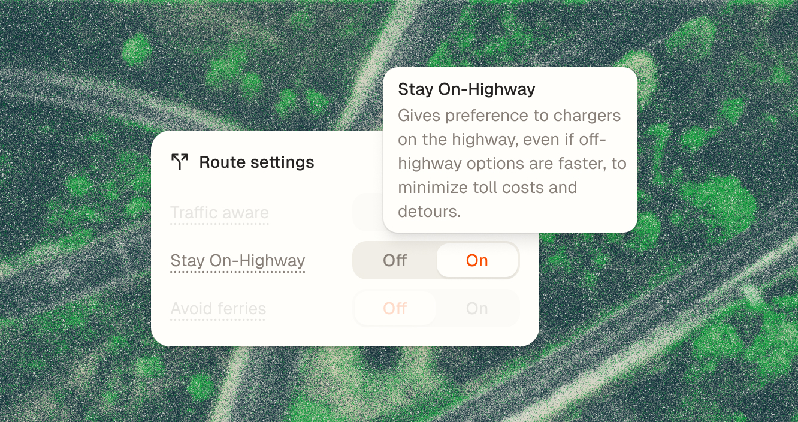

## Otoyol şarj tercihi

Bu yeni seçenek, otoyol dışındaki istasyonlar daha hızlı bir rota sunsa bile otoyolda bulunan şarj cihazlarına öncelik verir.

  
Düzeltmeler

  - Kendi yolunu tekrar eden rotaların negatif şarj durumuyla sonuçlanabildiği sorun düzeltildi.
  - `OPTIMIZE_TRAVEL_TIME` şarj modu özel bir son şarj durumuyla birlikte kullanıldığında, son duraktaki şarj süresinin yanlış hesaplandığı sorun düzeltildi.

