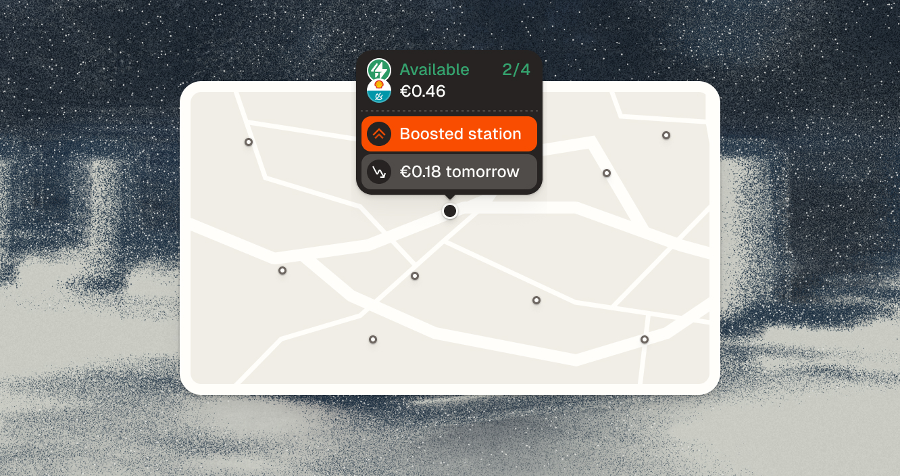

## İstasyon Öne Çıkarma ile rotaları yönlendirin

Ağ kullanımını en üst düzeye çıkarmak, iş ortağı anlaşmalarına uymak veya sürücüleri yüksek marjlı belirli şarj istasyonlarına yönlendirmek isteyen işletmeler için İstasyon Öne Çıkarma, rota kararlarını etkilemenin kolay bir yolunu sunar. Alpha olarak sunulan bu özellik, gereksiz operasyonel karmaşıklık eklemeden belirli şarj noktalarına nasıl öncelik verileceği üzerinde doğrudan kontrol sağlar.

- Hedefli İstemci Grupları: Hedefli bölgesel veya zamana dayalı kampanyalar yürütmek için ortam başına en fazla 5 ayrı grup oluşturun (grup başına en fazla 50 belirli istasyon).

Bu özelliği test etmek ve hacmi yüksek öncelikli donanımlara yönlendirmeye başlamak isterseniz, yapılandırmanızı yönetmek için lütfen Müşteri Başarı Yöneticinizle iletişime geçin.

### Yapılandırılabilir maksimum şarj SoC'si ve genişletilmiş batarya sınırları
Sürücüler artık şarj durakları için maksimum şarj durumunu (SoC) %80 ile %100 arasında yapılandırabilir ve varışta daha yüksek kalan batarya seviyesi gerektiren yolculuklar planlayabilir.

- `createRoute` içinde (`RouteVehicleChargingInput`) `maximum_state_of_charge` (%80–100) değerini iletin. Ayarlandığında, araçlar hem `ALWAYS_TO_MAX_CHARGE` hem de `OPTIMIZE_TRAVEL_TIME` modlarında planlı veya plansız duraklarda varsayılan %80 sınırının ötesinde şarj olabilir;
- `final_state_of_charge` değerini araç batarya kapasitesinin %80'ine kadar yapılandırın (önceden %60);
- İki yeni SoC bölüm uyarısı eklendi: beklenen varış SoC'si güvenlik risk marjının altına düştüğünde `risk_margin_soc_not_possible`, istenen son SoC güvenli risk marjının altına düştüğünde ise `final_soc_below_risk_margin`.

  
İyileştirmeler

  - `vehicleMakes` sorgusuna (`VehicleMakesFilter`) `type` ve `region` dizi filtreleri eklendi; böylece istemciler belirli araç türleri sunan veya belirlenen coğrafi bölgelerde faaliyet gösteren markaları filtreleyebiliyor.
  - Marka başına erişilebilir model sayısını ve model başına araç sayısını gerçek zamanlı olarak sunmak için `VehicleMake` türüne `model_count`, `VehicleModel` türüne `vehicle_count` eklendi.
  - `vehicleMakes` sorgusuna, `total_count` ve `page_info` ile birlikte imleç tabanlı sayfalandırma argümanları (`first` ve `after`) eklendi.
  - `vehicleMakes` ve araç sorguları, bir ülke filtresi sağlandığında ülkeye özgü marka logolarını döndürecek şekilde güncellendi; yerelleştirilmiş varlıklar yapılandırılmamışsa genel görsellere geri dönülüyor.

  
Düzeltmeler

  - `vehicleList` içinde, marka ID'leri getirildikten sonra marka adına göre filtrelemenin başarısız olduğu sorun düzeltildi; `filter.make` artık hem marka ID'lerini hem de marka adlarını kabul ederek geriye dönük uyumluluk sağlanıyor.
  - Güvenlik risk marjının altında bir başlangıç şarj durumuyla (`initialSOC < safeRiskMargin`) başlayan rotaların, en yakın kullanılabilir şarj istasyonuna yönlendirmek yerine batarya %0'a ulaşana kadar sürdüğü sorun düzeltildi.
  - Rota ayrıntılarında bölüm sürelerinin toplamının toplam sürüş süreleriyle (`durations.driving`) uyuşmadığı sorun düzeltildi.

