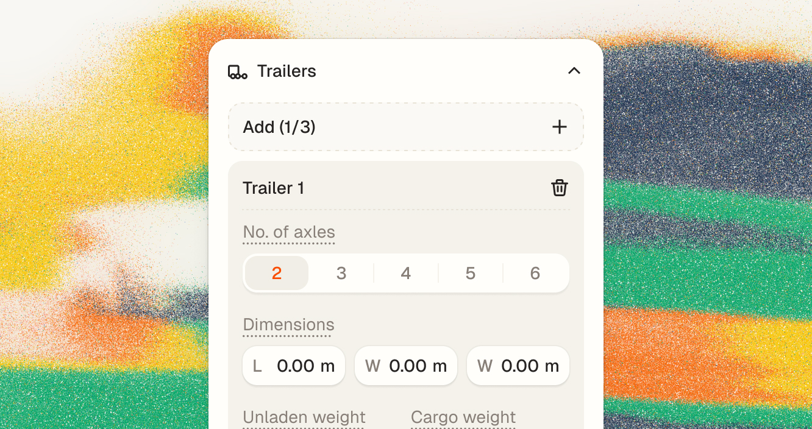

## Kamyon rotası

Özel kamyon rota motorumuzu arka uçta resmi olarak kullanıma sunduk. Yepyeni bir sorgu ve mutasyon setiyle erişilen bu bağımsız API özelliği, ağır elektrikli araçlar için güvenilir ticari rotalar oluşturmak üzere ağırlık sınırlarını, yükseklik kısıtlarını ve kamyona özgü enerji tüketim modellerini dikkate alır.

  
İyileştirmeler

  - createRoute içinde via şarj istasyonları belirtilirken doğrulama ve teşhis hata raporlaması iyileştirildi; şarj mümkün olmadığında açık hata kodları (`ROUTE_STATION_OUT_OF_SERVICE`, `ROUTE_STATION_INVALID_CHARGER` ve iyileştirilmiş `ROUTE_STATION_INVALID_SPEED`) döndürülüyor, mevcut konnektörler istenen minimum_power eşiğinin altına düştüğünde ise via_station_below_minimum_power bölüm uyarısı sunuluyor.

  
Düzeltmeler

  - `traffic_aware` etkinleştirildiğinde, önerilen ve alternatif rotalardaki toplam sürüş ve yolculuk sürelerinin (`durations.driving` ve `durations.total`) trafik gecikmelerini içermediği sorun düzeltildi.
  - Bir şarj istasyonunda biten rotaların son bölümde hatalı bir şarj süresi kaydettiği ve rotanın toplam `charges` sayısına fazladan bir şarj durağı eklediği sorun düzeltildi.
  - `vehicleList` sorgusunun `make` veya `model` değerlerinde özel karakterler (`Lynk&Co`, `e.GO`, `ID.7` veya `N°4 E-Tense` gibi) bulunan dizelerle filtrelenmesinin boş sonuç döndürdüğü sorun düzeltildi.
  - `amenityList` içinde filtrelenmiş POI arama sonuçlarının istasyonun toplam olanak sayısıyla eşleşmediği sorun düzeltildi.

