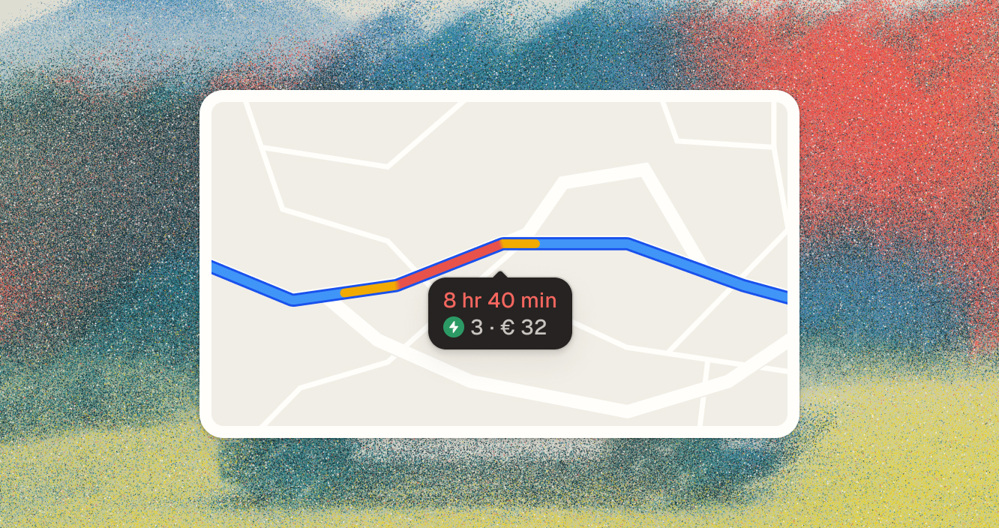

## Trafik

Rotaları hesaplarken küresel trafik etkisi için trafiğe duyarlı rota planlamayı etkinleştirin. Şarj optimizasyonu yapılırken trafiği ve olayları hesaba katmak, uzun zamandır EV rota optimizasyonunun kutsal kasesi olarak görülüyor. Etkinleştirildiğinde rota yanıtı şunları içerir:

- Rotanın trafikten etkilenen **segmentleri**;
- Bu segmentlerdeki **yoğunluk seviyesi**;
- Toplam rota süresine eklenen **gecikme**.

Bu, trafik koşulları rotayı etkilediğinde daha gerçekçi bir seyahat süresi tahmini sunar ve müşterilerinize adım adım navigasyona hazır, küresel olarak optimize edilmiş rotalar vermenizi sağlar.

### Rota uyarıları

Rota planlama çoğu zaman elinden gelenin en iyisini yapma sürecidir. Bazen rota motoru, istenen tüm koşulları tam olarak karşılayamaz. Uyarılar, bir rotanın özgün istekten neden farklı olabileceğini açıklamaya yardımcı olur. Örnekler şunlardır:

- **Kullanılamayan operatörler**: tercih edilen şarj operatörlerine ait istasyonlar bu rota bölümü için kullanılabilir değil.
- **Kısıtlar**: istenen son şarj durumuna ulaşılamadı.

Uyarılar, ön uç ekiplerinin sürücülere yararlı geri bildirim sunmasına veya mühendislere rota planlama davranışı hakkında daha derin bilgi vermesine olanak tanır. Bu, rota sonuçlarını anlamayı ve uç durumlarda sorun gidermeyi kolaylaştırır.

  
İyileştirmeler

    - `createRoute` içinde operatör sıralaması doğrulaması esnetildi: operatör tercihleri (tercih edilen veya zorunlu) istekte seviyeler sağlanmadan veya proje ayarlarında yapılandırılmadan talep edilirse, rota hesaplaması artık operatör önceliklendirmesi olmadan başarıyla tamamlanıyor ve getRoute içinde kesintiye yol açmayan bir `OPERATOR_PREFERENCES_NOT_FOUND` uyarısı döndürüyor (ayrıca /public/warnings üzerinden belgelenmiştir).

  
Düzeltmeler

  - Araç listesinin (vehicleList) parantez içeren dizelerle (araç markası veya model adları gibi) aranması veya filtrelenmesinin sorgu ayrıştırma hatalarına ve dahili sunucu hatası döndürülmesine neden olduğu sorun düzeltildi.

