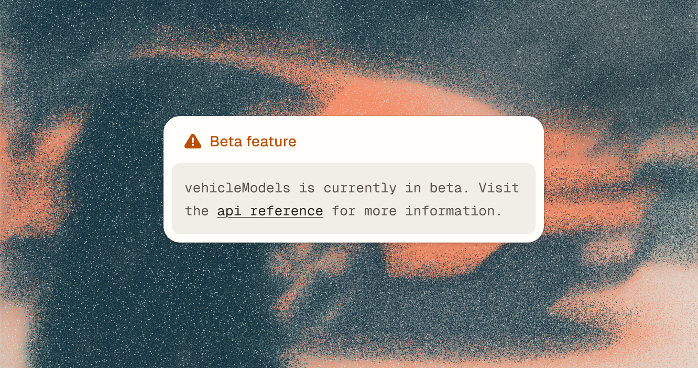

## Deneysel ve kullanımdan kaldırma API uyarıları

İstenen bir işlem veya alan alpha ya da beta aşamasında olduğunda veya kullanımdan kaldırılması planlandığında geliştiricileri bilgilendirmek için GraphQL yanıt uzantılarına yaşam döngüsü uyarıları ekledik. Bu, API yanıtlarını bozmadan özelliğin olgunluğu ve yaklaşan kullanımdan kaldırmalar hakkında doğrudan görünürlük sağlar.

Yenilikler:

- **Yaşam döngüsü bildirimleri**: İsteğiniz `@experimental(stage: "alpha")`, `@experimental(stage: "beta")` veya `@chargetripdeprecated` ile işaretlenmiş şema öğelerine dokunduğunda `extensions.warnings` altında yapılandırılmış uyarılar alın;
- **Tutarlı iletim**: İşlemin başarılı olup olmadığına veya hata döndürüp döndürmediğine bakılmaksızın uyarılar tüm yanıtlara dahil edilir.

  
İyileştirmeler

    - `createIsoline`, yeni `weather` girdisi aracılığıyla standart ön ayarların (`summer`, `winter`, `actual`) yanı sıra özel hava koşullarını (`temperature`, `air_pressure` ve `solar_irradiance`) destekleyecek şekilde genişletildi; `season` girdisi kullanımdan kaldırıldı.
    - Rota bölümü düzeyinde istasyon çalışma durumu uyarıları (`station_closed`, `station_closing_soon` ve `station_unknown_open_hours`) eklendi ve `station_limited_open_hours` uyarısı, rotadaki bir istasyonun varışta kapalı olabileceği veya sınırlı/bilinmeyen çalışma saatlerine sahip olabileceği konusunda sürücüleri uyaracak şekilde iyileştirildi.
    - Şema ek açıklamaları standartlaştırıldı: Isoline, Routing V2 ve Navigation GraphQL şemalarında sabit kodlanmış `[BETA]` metin açıklamaları resmi `@experimental(stage: "beta")` yönergesiyle değiştirildi.

  
Düzeltmeler

    - getRoute içinde, parasal tasarruf oluşmadığında BEV rotalarında savings.money değerinin 0 yerine null döndürdüğü sorun düzeltildi.

