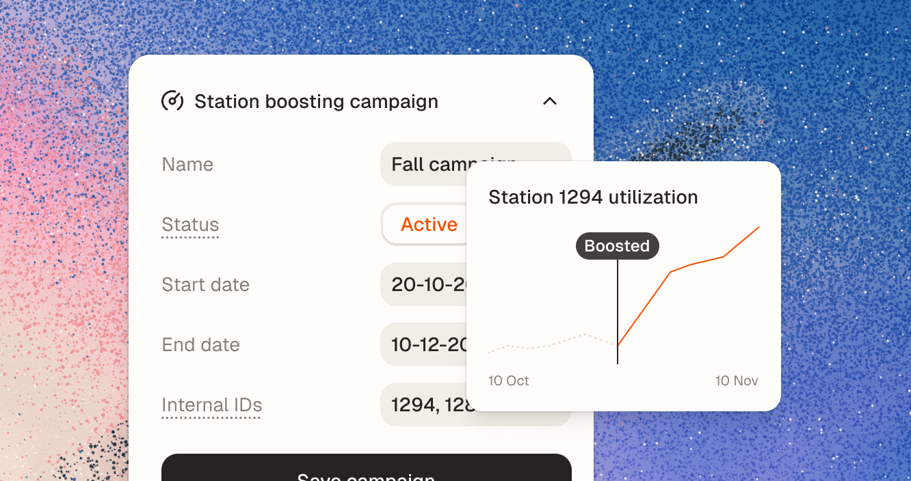

## Admin API ile istasyon öne çıkarma gruplarını yönetin

Yeni bir Admin API (`https://admin.chargetrip.io/graphql`) aracılığıyla istasyon öne çıkarma gruplarını oluşturma, güncelleme, silme, listeleme ve tek tek alma dahil olmak üzere yönetme desteği ekledik. Kimliği doğrulanmış istemciler, rotalamada öncelik vermek için hızlı ve ultra hızlı şarj istasyonlarından oluşan en fazla beş etkin öne çıkarma grubu tanımlayabilir.

Pano da, herkese açık Admin API erişim belirteçlerini güvenli biçimde oluşturmayı, önizlemeyi ve silmeyi destekleyecek şekilde güncellendi. Daha fazla bilgi için [Admin API referansına](/api-reference/admin) bakın.

### Tile Service'te gerçek zamanlı istasyon fiyatları

Tile Service (v2) istasyon özellikleri artık kWh başına gerçek zamanlı anlık şarj fiyatlarını içeriyor; böylece istasyonları geçerli enerji fiyatlarına göre filtreleyebilirsiniz (`maximum_energy_price`).

- Fiyatlar sunucu tarafında istenen ISO-4217 para birimine dönüştürülür, varsayılan para birimi EUR'dur;
- Fiyatlar, her istasyonun yerel saat dilimine göre saat bazında dinamik olarak değerlendirilir;
- Şu anda yalnızca Eco-Movement veritabanı için kullanılabilir. Diğer veritabanları da izleyecek. Daha fazla bilgi için Müşteri Başarı Yöneticinizle iletişime geçin.

  
İyileştirmeler

  - Yönlendirme ayarlarında tanımlanan zorunlu operatörlerden hiçbirine ait olmayan bir ara istasyonun veya varış istasyonunun ne zaman söz konusu olduğunu belirten `via_station_not_required_operator` eklenerek bölüm düzeyindeki uyarılar iyileştirildi.
  - Olanak adres kayıtlarındaki `continent` alanı ülkeye göre otomatik olarak doldurularak olanak veri yapısı iyileştirildi.
  - Uyumsuz duraklamaları önlemek için sıkı araç uyumluluğu doğrulamaları içeren varış istasyonlarındaki doğrulamalar iyileştirildi.
  - Ara istasyon duraklama süreleri sabit bir üst sınır yerine asgari duraklama süresi olarak yorumlanacak şekilde iyileştirildi; böylece rotalama motoru duraklama süresini uzatarak toplam seyahat süresini optimize edebiliyor.
  - Kullanıcıya dönük hata mesajları, profesyonel metin yazarlığı yönergeleriyle uyum sağlamak için ünlem işaretleri yerine nokta kullanılarak iyileştirildi.

  
Düzeltmeler

  - Alternatif rotalar istenirken önerilen rotanın şarj veya mesafe alanlarında null olamayan alan hatasının tetiklenebildiği sorun düzeltildi.
  - `getRouteStationsWithAmenities` sorgusunda `null` olarak ayarlanmış istasyon operatörü tercihlerine göre filtrelemenin sunucu hatasına neden olduğu sorun düzeltildi.
  - `vehicleMakes` ve `vehicleModels` üzerinde sayfalandırma açıklamalarının, sayfa başına döndürülen en fazla öğe sayısını 100 yerine 10 olarak yanlış belirttiği sorun düzeltildi.
  - Değerler güvenli sınırlara eşit olduğunda veya son SoC belirtilmediğinde `risk_margin_soc_not_possible` ve `final_soc_not_possible` uyarılarının yanlışlıkla döndürüldüğü sorun düzeltildi.
  - Birden fazla rota eş zamanlı sorgulandığında rotalardan birinin recommended alanının yanlışlıkla `null` döndürebildiği sorun düzeltildi.
  - Bir isoline hesaplanırken boş bir koordinat dizisi gönderilmesinin, kullanıcı dostu bir doğrulama hatası yerine dahili sunucu hatasıyla sonuçlandığı sorun düzeltildi.
  - `@ocpi` şema yönergesinin GraphQL alan açıklamalarına *"This property is OCPI-compliant."* ekini eklemediği sorun düzeltildi.

