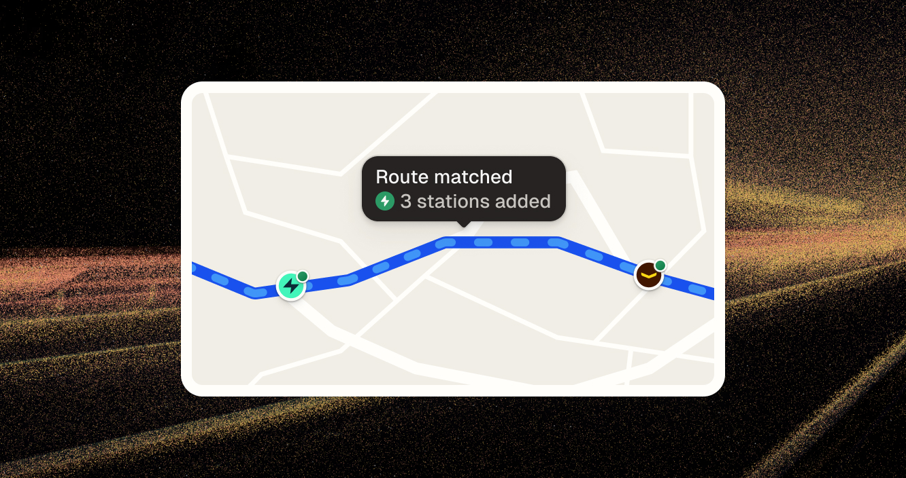

## Rota eşleştirme

Rota Eşleştirme işlemlerini kullanıma sunduk. Bu işlemler, harici GPS izlerini haritayla eşleştirmenize ve bunları Rota Motorumuzdan geçirerek enerji tüketimini hesaplamanıza ve en uygun şarj duraklarını eklemenize olanak tanır.

- Yeni `createMatchedRoute` mutasyonunu kullanarak koordinat dizilerinden eşleştirilmiş rotalar hesaplayın;
- Koordinat dizisi indeksiyle (`via.index`) tanımlanan `vias` ile ara duraklar belirleyin; yolculuk boyunca araç yolcu sayısını ve yük ağırlığını dinamik olarak güncelleme desteği de mevcuttur;
- Önceden belirlenmiş güzergah boyunca araç enerji tüketimini değerlendirmek ve gerektiğinde uyumlu şarj duraklarını otomatik olarak eklemek için `plan_charging_stops: true` değerini etkinleştirin;
- Tamamlanmış eşleştirilmiş rotalar için tam CO₂ emisyon profillerini `getRouteEmissions` ile sorgulayın.

  
İyileştirmeler

    - Operatör sorgusu, dahili id'nin yanı sıra bir external_id değerini de kabul edecek şekilde güncellendi.

  
Düzeltmeler

    - Büyük harf içeren bir e-posta adresiyle panoya kaydolmanın, bekleyen çalışma alanı davetlerinin giriş yapıldığında görüntülenmesini engellediği sorun düzeltildi.
    - Rota ayrıntılarında bölüm sürücülük sürelerinin toplamının toplam sürücülük süreleriyle (`durations.driving`) eşleşmemesine neden olan hesaplama ve yuvarlama tutarsızlığı düzeltildi.

