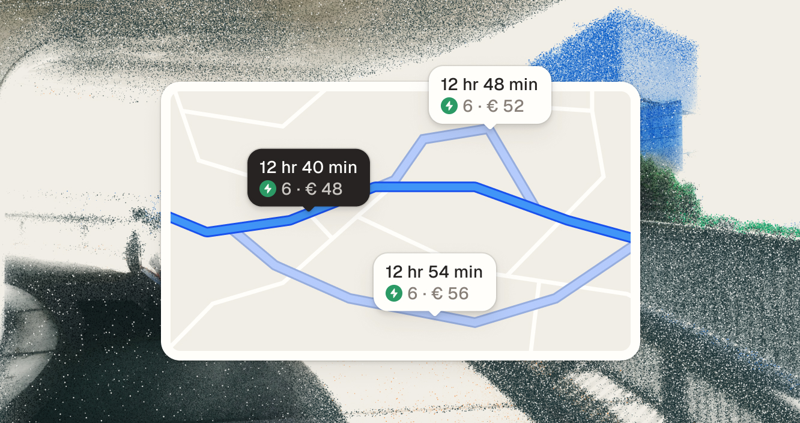

## 备选路线

现在，您可以在路线计算期间，与推荐路线一并请求地理位置上不同的备选路线。这让驾驶员和调度员可以在保持相同行程约束的前提下，根据自己的偏好评估备选路径。您最多可以指定 2 条备选路线。

  
修复

    - 修复了在 `createRoute` 中提供不含几何、位置或充电站 ID 的空 `via` 途经点时，会以 `not_found` 状态静默失败，而不是返回 `ROUTE_VIA_LOCATION_MISSING` 验证错误的问题。
    - 修复了 `operatorList` 中的一个问题：如果项目未配置排除的国家，使用排名筛选的查询会返回空结果，现在可以正确返回符合排名偏好的运营商。

