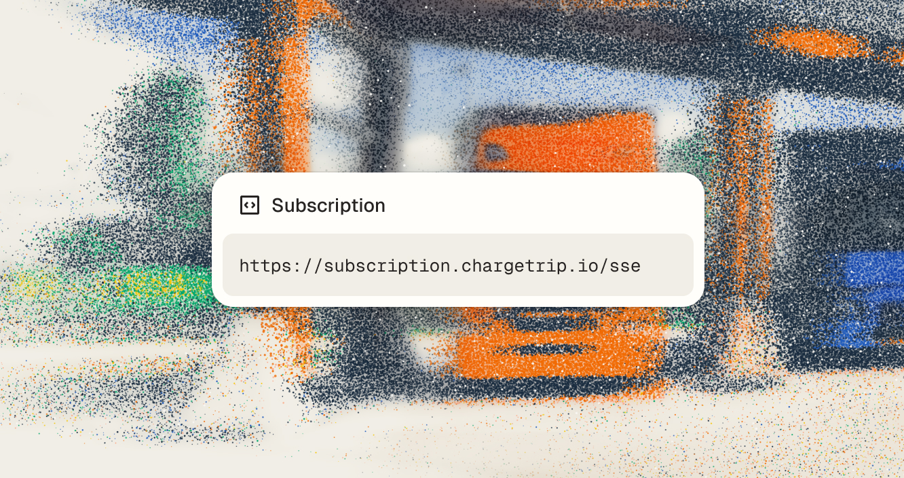

## 订阅 v2

我们推出了全新的订阅服务，托管在专用域名（`subscription.chargetrip.io`）下，带来更高的可靠性、标准子协议以及新的传输方式选择。

- 使用现代的 `graphql-transport-ws` 协议，通过 `wss://subscription.chargetrip.io/ws` 以 WebSocket 方式连接；
- 通过 `https://subscription.chargetrip.io/sse`，使用 Server-Sent Events 以 HTTP 方式流式传输订阅；
- 当资源达到最终状态时（例如路线/等值线的 `done`、`error` 或 `not_found`，以及导航的 `finished` 或 `error`），活跃的订阅连接会自动关闭；
- 错误负载现在遵循一致的 GraphQL 错误约定，并附带结构化的扩展元数据。

### 充电站查询中的充电站提升组

我们扩展了充电站查询，以便查看某个充电站是否属于活跃的提升组。

- 在 `station`、`stationList` 和 `stationAround` 查询的 `Station` 类型中新增了 `boosting_group_ids` 字段；
- 返回为您的项目配置的活跃提升组 ID 数组；如果该充电站当前未被提升，则返回空列表（`[]`）。

  
修复

  
  - 修复了包含多个渡轮连接的路线可能导致车辆抵达充电站时电量状态（State of Charge）为负的问题。
  - 修复了在起点和终点位置非常接近时计算路线会产生无效线串（line string）错误，并以 404 响应失败的问题。

