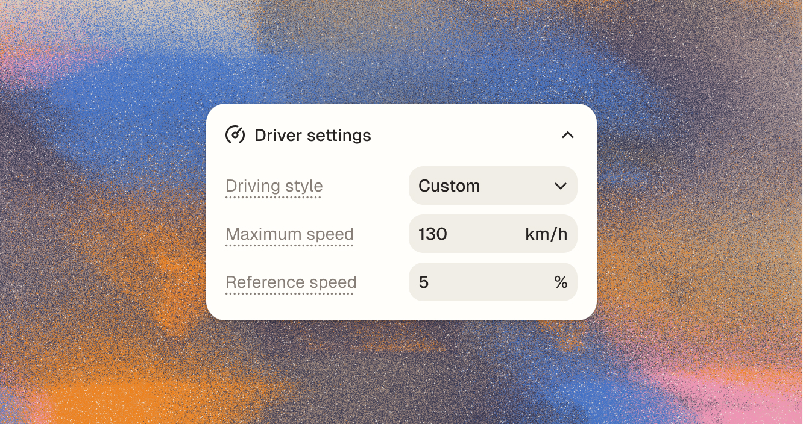

## 驾驶风格

行驶速度直接影响 EV 的能耗。为了让路线更准确地反映真实的车辆行为和行程时长，我们引入了两项新的控制：速度系数和驾驶风格。

驾驶风格会改变预计到达时间和能耗。

- **Eco** 假定更从容、更高效的车速，以节省电池电量；
- **Sport** 假定更高的车速和更大的能耗，以便更快到达。

这些功能让您可以根据车辆的实际驾驶方式调整路线计算，从而得到更精确的能耗估算和到达时间。

### 更新后的 getRouteStationsWithAmenities Schema

我们更新了 `getRouteStationsWithAmenities` 查询，以简化输入并支持多设施筛选。

- **多设施搜索**：使用逻辑 OR 筛选，同时查询多个设施类别；
- **直接时间输入**：直接以距路线起点的秒数传入时间窗口；
- **外部充电站 ID**：可在充电站节点上访问 `external_id`。
