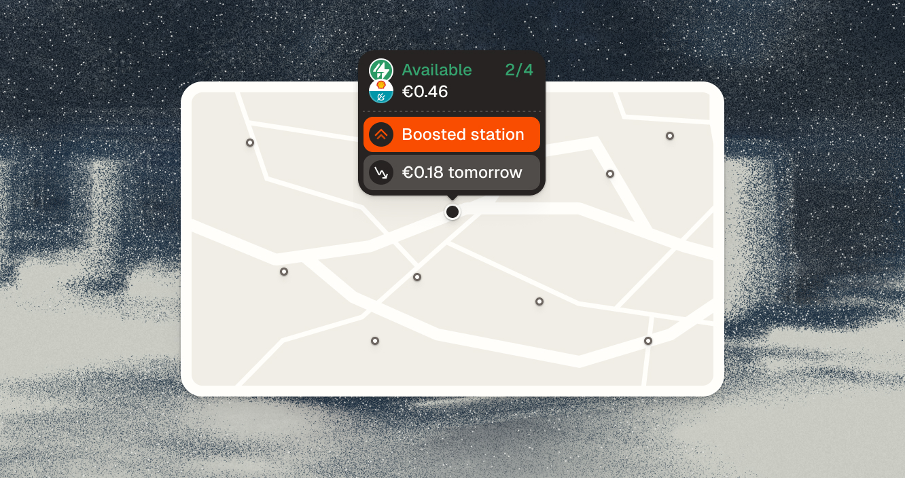

## 通过充电站推广影响路线

对于希望最大化网络利用率、履行合作伙伴协议，或引导驾驶员前往特定高利润充电站的企业，充电站推广（Station Boosting）提供了一种简化的方式来影响路线决策。此功能目前处于 Alpha 阶段，让您可以直接控制特定充电地点的优先级，而不会增加不必要的运营复杂性。

- 定向客户组：每个环境最多可创建 5 个不同的组（每组最多包含 50 个特定充电站），用于开展定向的区域或基于时间的活动。

如果您想测试此功能并开始将流量引导至高优先级的硬件，请联系您的客户成功经理来管理您的配置。

### 可配置的最大充电 SoC 与扩展的电池限制
驾驶员现在可以为充电停靠点配置 80% 至 100% 之间的最大电量状态（SoC），并规划到达时需要更高剩余电量的行程。

- 在 `createRoute`（`RouteVehicleChargingInput`）中传入 `maximum_state_of_charge`（80–100%）。设置后，在 `ALWAYS_TO_MAX_CHARGE` 和 `OPTIMIZE_TRAVEL_TIME` 两种模式下，车辆在计划或非计划停靠期间都可以充电超过默认的 80% 上限；
- 可将 `final_state_of_charge` 配置为最高达到车辆电池容量的 80%（此前为 60%）；
- 新增两个 SoC 路段警告：当预计到达 SoC 低于安全风险余量时为 `risk_margin_soc_not_possible`，当请求的最终 SoC 低于安全风险余量时为 `final_soc_below_risk_margin`。

  
改进

  - 为 `vehicleMakes`（`VehicleMakesFilter`）添加了 `type` 和 `region` 数组筛选，让客户端可以筛选提供特定车辆类型或在指定地理区域运营的品牌。
  - 为 `VehicleMake` 添加了 `model_count`，为 `VehicleModel` 添加了 `vehicle_count`，以提供每个品牌下可访问车型的数量以及每个车型下车辆的数量的实时统计。
  - 在 `vehicleMakes` 查询上实现了基于游标的分页参数（`first` 和 `after`），以及 `total_count` 和 `page_info`。
  - 更新了 `vehicleMakes` 和车辆查询，在提供国家筛选时返回特定国家的品牌徽标，当未配置本地化资源时回退到全球图片。

  
修复

  - 修复了 `vehicleList` 中的一个问题：引入品牌 ID 后，按品牌名称筛选会失败。现已恢复向后兼容，`filter.make` 同时接受品牌 ID 和品牌名称。
  - 修复了以低于安全风险余量的初始电量状态（`initialSOC < safeRiskMargin`）出发的路线会一直行驶到电量降至 0%，而不是前往最近的可用充电站的问题。
  - 修复了路线详情中各路段分段时长之和与总行驶时长（`durations.driving`）不一致的问题。

