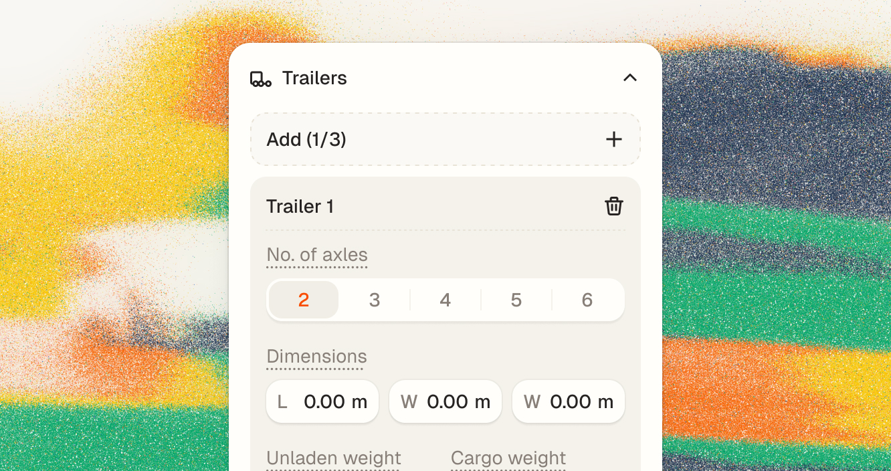

## 货车路线规划

我们已在后端正式推出专用的货车路线规划引擎。通过全新的一组查询和 mutation 即可访问，这一独立的 API 功能会综合考虑重量限制、高度限制和货车专用的能耗模型，为重型电动车辆构建可靠的商用路线。

  
改进

  - 改进了在 createRoute 中指定途经充电站时的验证和诊断错误报告：当无法充电时返回明确的错误代码（`ROUTE_STATION_OUT_OF_SERVICE`、`ROUTE_STATION_INVALID_CHARGER` 以及优化后的 `ROUTE_STATION_INVALID_SPEED`），并在可用连接器低于请求的 minimum_power 阈值时引入 via_station_below_minimum_power 路段警告。

  
修复

  - 修复了启用 `traffic_aware` 时，推荐路线和备选路线上的总行驶时长和总行程时长（`durations.driving` 和 `durations.total`）未包含拥堵延误的问题。
  - 修复了以充电站为终点的路线在最后一个路段记录了错误的充电时长，并在路线的 `charges` 总数中多增加了一个充电停靠点的问题。
  - 修复了按包含特殊字符（例如 `Lynk&Co`、`e.GO`、`ID.7` 或 `N°4 E-Tense`）的 `make` 或 `model` 字符串筛选 `vehicleList` 时返回空结果的问题。
  - 修复了 `amenityList` 中的一个问题：经筛选的兴趣点（POI）搜索结果与充电站的设施总数不一致。

