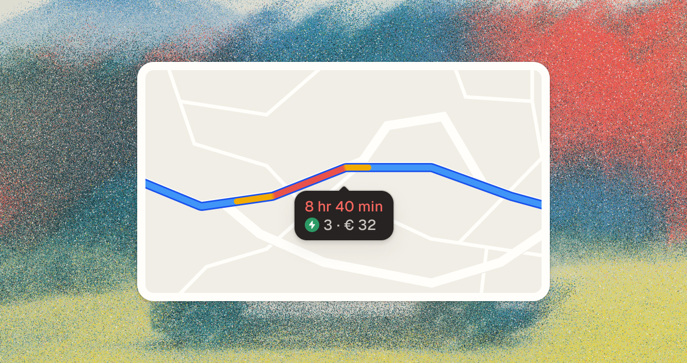

## 交通

在计算路线时启用感知交通的路线规划，以考虑全球范围内的交通影响。在优化充电的同时兼顾交通和事故信息，长期以来一直被视为 EV 路线优化的圣杯。启用后，路线响应会包含：

- 受交通影响的路线**路段**；
- 这些路段的**拥堵程度**；
- 增加到路线总时长中的**延误**。

当交通状况影响路线时，这能提供更真实的行程时间估算，并让您能够为客户提供全局优化、可直接用于逐向导航的路线。

### 路线警告

路线规划往往是尽力而为的过程。有时路线引擎无法完全满足所有请求的条件。警告有助于说明路线为何可能与原始请求不同。示例包括：

- **运营商不可用**：此路线路段上没有偏好充电运营商的充电站。
- **约束**：无法达到请求的最终电量状态。

警告让前端团队能够向驾驶员展示有用的反馈，也让工程师更深入地了解路线规划行为。这使理解路线结果和排查边缘情况变得更加容易。

  
改进

    - 放宽了 `createRoute` 中运营商排名的验证：如果请求了运营商偏好（首选或必选），但请求中未提供级别，项目设置中也未配置，现在路线计算会在不进行运营商优先排序的情况下成功完成，并在 getRoute 中返回不会中断流程的 `OPERATOR_PREFERENCES_NOT_FOUND` 警告（同时记录在 /public/warnings 中）。

  
修复

  - 修复了使用包含括号的字符串（例如车辆品牌或车型名称）搜索或筛选车辆列表（vehicleList）时，会导致查询解析失败并返回内部服务器错误的问题。

