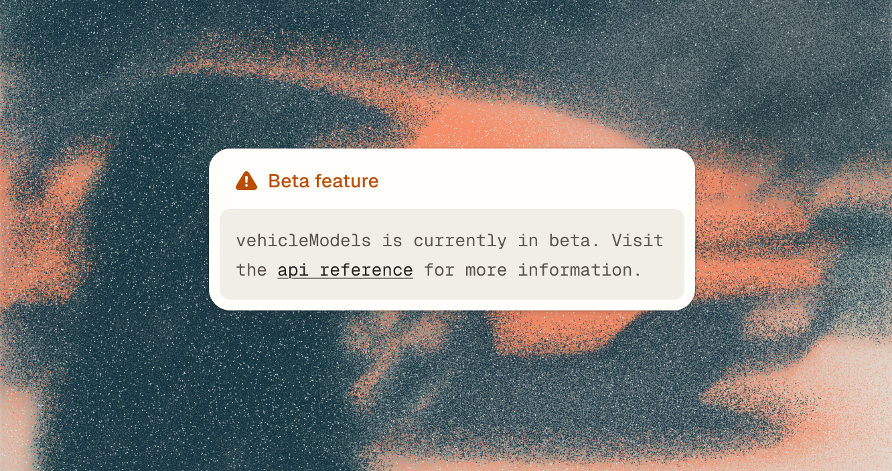

## 实验性功能和弃用 API 警告

我们在 GraphQL 响应扩展中引入了生命周期警告，每当所请求的操作或字段处于 alpha、beta 阶段或计划弃用时，都会通知开发者。这让您可以直接了解功能的成熟度和即将到来的弃用，同时不会影响 API 响应。

新增内容：

- **生命周期通知**：每当您的请求涉及标记为 `@experimental(stage: "alpha")`、`@experimental(stage: "beta")` 或 `@chargetripdeprecated` 的 schema 元素时，会在 `extensions.warnings` 下收到结构化的提醒；
- **一致的交付**：无论操作成功还是返回错误，所有响应中都会包含警告。

  
改进

    - 扩展了 `createIsoline`，通过新的 `weather` 输入，在标准预设（`summer`、`winter`、`actual`）之外支持自定义天气条件（`temperature`、`air_pressure` 和 `solar_irradiance`），并弃用了 `season` 输入。
    - 在路线路段级别添加了充电站运营状态警告（`station_closed`、`station_closing_soon` 和 `station_unknown_open_hours`），并优化了 `station_limited_open_hours`，以便在路线上的充电站在驾驶员到达时可能已关闭或营业时间有限/未知时向其发出警告。
    - 标准化了 schema 注解：在 Isoline、Routing V2 和 Navigation GraphQL schema 中，用正式的 `@experimental(stage: "beta")` 指令取代了硬编码的 `[BETA]` 文本描述。

  
修复

    - 修复了 getRoute 中的一个问题：在 BEV 路线上没有产生任何金钱节省时，savings.money 返回 null 而不是 0。

