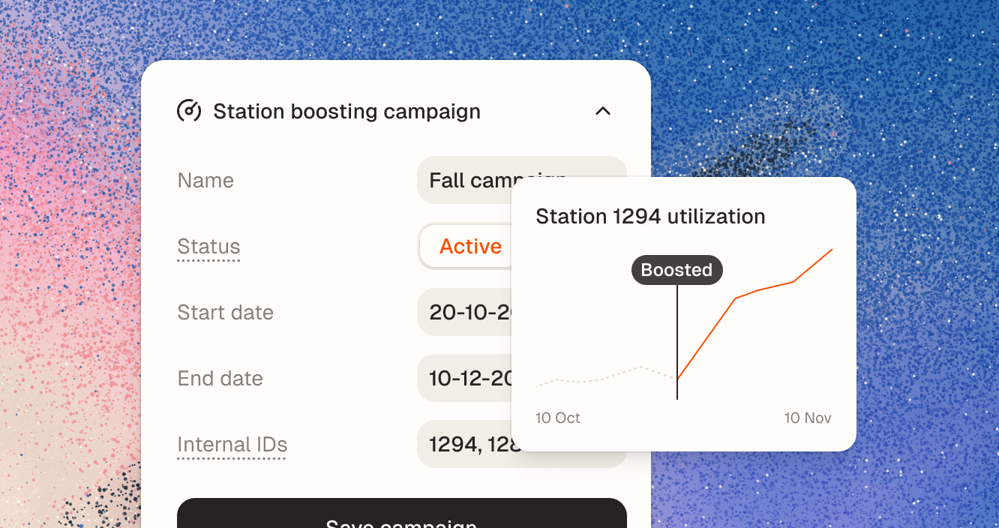

## 使用 Admin API 管理充电站推广组

我们通过全新的 Admin API（`https://admin.chargetrip.io/graphql`）增加了对管理充电站推广组的支持，包括创建、更新、删除、列出和单独获取。经过身份验证的客户端最多可以定义五个由快速和超快速充电站组成的活跃推广组，以便在路线规划中优先考虑这些充电站。

Dashboard 也已更新，以支持安全地生成、预览和删除公共 Admin API 访问令牌。更多信息请参阅 [Admin API 参考](/api-reference/admin)。

### Tile Service 中的实时充电站价格

Tile Service（v2）的充电站属性现在包含每 kWh 的实时临时充电价格，让您可以根据充电站当前的能源价格（`maximum_energy_price`）筛选充电站。

- 价格会在服务器端转换为请求的 ISO-4217 货币，默认为 EUR；
- 价格会根据每个充电站的当地时区按小时动态评估；
- 目前仅适用于 Eco-Movement 数据库，其他数据库将陆续支持。如需更多信息，请联系您的客户成功经理。

  
改进

  - 通过新增 `via_station_not_required_operator` 改进了路段级警告，用于指示途经或目的地充电站不属于路线设置中定义的任何必需或强制运营商。
  - 通过根据国家自动填充设施地址记录上的 `continent` 字段，改进了设施数据结构。
  - 改进了对目的地充电站的验证，采用严格的车辆兼容性验证，以防止出现不兼容的停靠。
  - 改进了对途经充电站停靠时长的解释，由硬性最大值改为最短停靠时长，使路线规划引擎可以通过延长停靠时长来优化整体行程时间。
  - 改进了面向用户的错误消息，将感叹号替换为句号，以符合专业文案规范。

  
修复

  - 修复了请求备选路线时，可能在推荐路线的 charges 或 distance 字段上触发非空字段错误的问题。
  - 修复了在 `getRouteStationsWithAmenities` 查询中，按设置为 `null` 的充电站运营商偏好进行筛选会导致服务器错误的问题。
  - 修复了 `vehicleMakes` 和 `vehicleModels` 上分页说明错误地将每页返回的最大条目数写为 10 而不是 100 的问题。
  - 修复了当值等于安全限值或未指定最终 SoC 时，错误返回 `risk_margin_soc_not_possible` 和 `final_soc_not_possible` 警告的问题。
  - 修复了同时查询多条路线时，其中一条路线的 recommended 字段可能错误地返回 `null` 的问题。
  - 修复了计算等值线时发送空坐标数组会导致内部服务器错误，而不是友好的验证错误的问题。
  - 修复了 `@ocpi` schema 指令未能在 GraphQL 字段描述后追加后缀 *"This property is OCPI-compliant."* 的问题。

